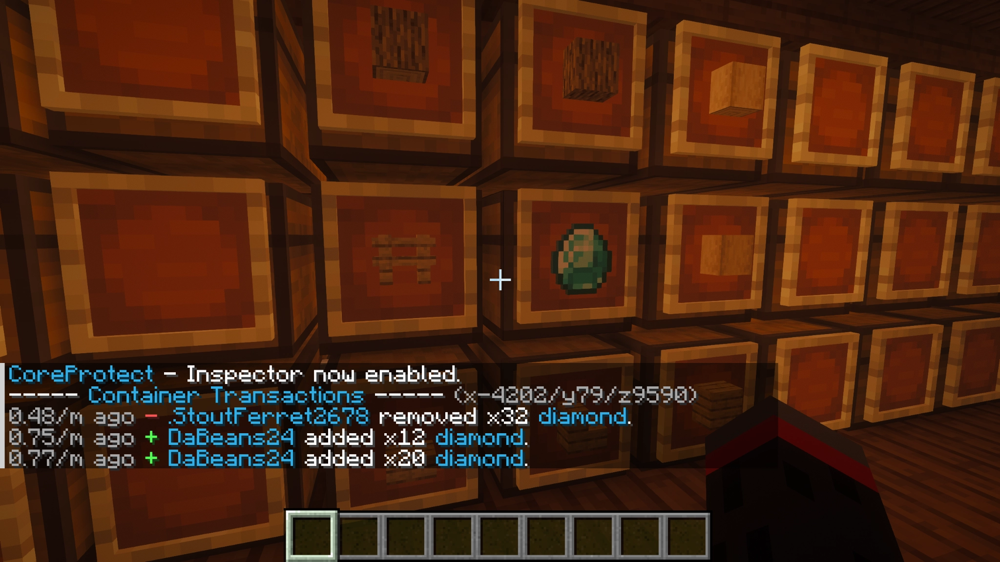
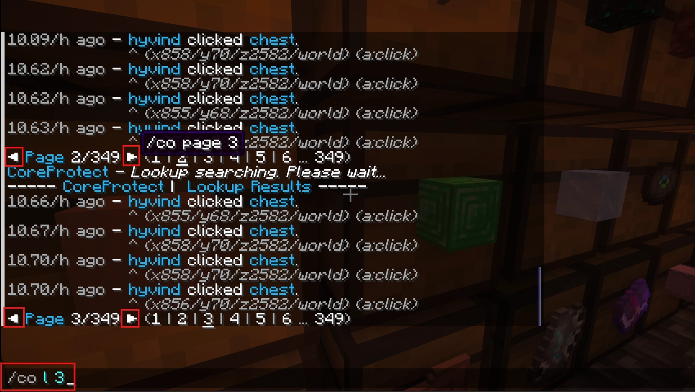
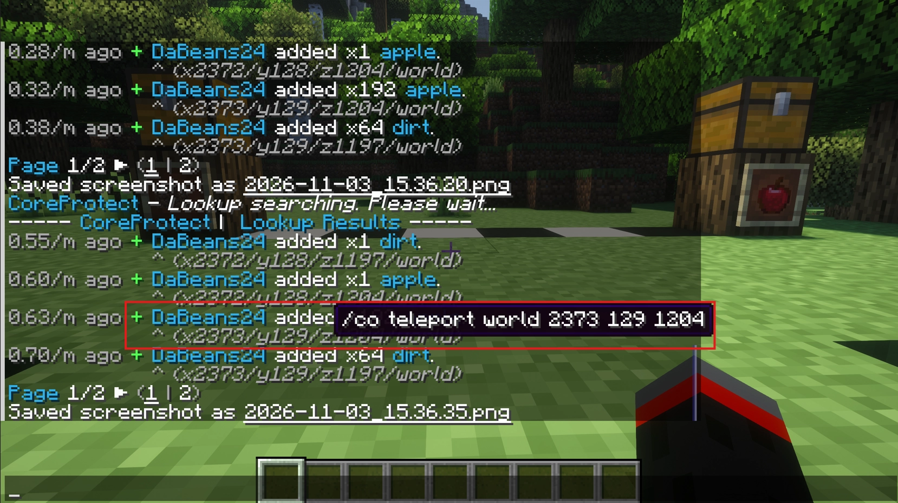

---
tags:
  - ADMIN
  - DEV
  - SERVER LEAD
---

# Module 2 · Player Investigations

One of the most important Admin responsibilities is figuring out what actually happened when a report cannot be resolved from the player's description alone.

Investigation tools give you access to information that ordinary players and Moderators may not have. That makes them useful, but it also means you need to interpret the results carefully.

---

## Building an Evidence Timeline

Start with the basic questions: **who, what, where, and when?**

For example, if a player reports that items disappeared from a chest, establish the world, chest coordinates, approximate last known time the items were present, and who had access.

A useful timeline separates three types of information:

| Type | Example |
| --- | --- |
| **Reported** | A player says 20 diamonds were taken overnight. |
| **Verified** | Container logs show another account removing items at a specific time. |
| **Unknown** | Whether the removal was authorized by the chest owner. |

Work from the smallest relevant time window and location. Widen the search only when the evidence indicates that you should.

!!! tip "Record times clearly"
    Console events, plugin logs, and Discord reports may use different timestamps or time zones. Record the time zone when it matters so later staff members do not accidentally compare unrelated events.

---

## Investigating With CoreProtect

[CoreProtect](../../plugins/permissions-and-moderation/coreprotect.md){ data-preview } records block changes, container transactions, and other supported actions. It is the main tool for verifying griefing and theft reports. Start at the reported location instead of searching the whole server.

### Using the Inspector

Turn on the inspector with:

```text
/co i
```

While it is enabled, **left-click a block** to check its placement history and **right-click a block** to inspect its removal history. For a reported chest, **right-click the chest**. On ERRSA, this can display the chest's **Container Transactions** directly, including items added and removed. You do not need to start with a broader lookup just to read that chest's history.

If several pages appear, use the **clickable arrows** or `/co l <page#>` to browse them. A real ERRSA example appears below.

CoreProtect may also show **clickable coordinates** beside entries. They can teleport you to the logged event, but always check that it is the reported chest.

Run `/co i` again when you finish to turn the inspector off. Inspector mode changes how clicks behave.

### Example: A Chest With Missing Items

A player says someone took diamonds from a chest while they were offline. You are standing beside the chest in Survival, and the owner estimates it happened within the last two hours. **You do not know who did it yet.**

1. **Confirm the basics.** Ask which chest, when they last saw the items, and whether anyone was allowed to use it. Record the world and coordinates.
2. **Inspect the exact chest first.** Run `/co i` and right-click the chest to see its Container Transactions. Look at the time, account, item, amount, and whether items were added or removed. Use the arrows or `/co l 2` if there are more pages. Turn the inspector off with `/co i` afterward.
3. **Use a wider lookup only when needed.** If the chest history does not cover the reported time, you need to check nearby containers, or you need to filter results, stand beside the reported chest and run:

    ```text
    /co lookup t:2h r:10 a:container
    ```

4. **Check the location on each result.** This lookup covers nearby containers, **not only the chest you clicked**. Compare coordinates before connecting an entry to the report. Click a listed location to teleport to it when you need to verify where the activity occurred.
5. **Narrow the search.** If the records point to an account such as `ExamplePlayer`, run:

    ```text
    /co lookup u:ExamplePlayer t:2h r:10 a:-container
    ```

6. **Check the explanation.** Compare the results with the owner's permissions, shared-storage arrangements, and any statements from the involved players. Record the finding before returning items or taking disciplinary action.

`r:10` means **ten blocks around your current in-game position**, not ten blocks around the chest automatically. Stand near the chest before searching. `t:2h` means the previous two hours. Leave out `u:` when the responsible account is unknown.

The `a:` filter helps distinguish results:

| Filter | Shows |
| --- | --- |
| `a:container` | Both items added to and removed from containers. |
| `a:-container` | Items removed from containers. |
| `a:+container` | Items added to containers. |
| `a:block` | Blocks placed or broken. |

!!! tip "Reading the results"
    A removal entry means items went out; an addition means items went in. Neither proves theft by itself. Look at the exact chest, time, and whether the storage is shared. You can use the chat arrows or `/co l <page#>` to browse the same history.

!!! tip "What if nothing appears?"
    **No results found** does not mean the report was false. You may be in the wrong world or location, the activity may be outside the time window, or the filter may not match what happened. Confirm the chest and coordinates, widen the time window if justified, and check whether you need container, block, inventory, or item history. If the result still does not make sense, record what you searched and ask for a second review.

!!! important "Keep the search small"
    A CoreProtect *lookup* without a radius can search much more broadly than expected. Start with a short time window and a location close to the report, then widen only if necessary. Do not roll back anything during the investigation.

For the full syntax, see the [CoreProtect command reference](https://docs.coreprotect.net/commands/){ target="_blank" }.

### Reading the Container Results

The example below is a **real ERRSA inspector result**, captured by right-clicking a chest with `/co i` enabled.



*The red `−` shows 32 diamonds removed; the green `+` shows 12 and 20 diamonds added. CoreProtect also gives the account and how long ago the action happened.*

These entries show **item movement**, not necessarily theft. The fact that the two additions add up to 32 does not prove the same diamonds were later removed, and it does not tell you whether the person who removed them had permission. Check the exact chest, timing, and any transactions between the visible entries.

### Moving Between History Pages



*The red boxes highlight both ways to move through the current results: click the chat arrows or enter `/co l <page#>` (here, `/co l 3`). The arrow's hover text may show `/co page 3`; both navigation methods open page 3 of that history.*

You can also click a page number shown in chat. If you start a **new** lookup, the pages will belong to those **new results**, not the chest history you were previously reading. Recheck what the title says before drawing conclusions.

### Opening Logged Coordinates



*Hover over a logged coordinate to see the CoreProtect teleport action. Clicking the location takes you to that event's coordinates, provided the command is permitted.*

This is particularly helpful when a radius lookup returns records from several nearby chests. **Teleporting shows where the event occurred; it does not prove the event belongs to the chest in the original report.** Confirm the world, location, and container before treating it as evidence.

??? question "Try reading the result"
    `ExamplePlayer` removed diamonds from a chest that several guild members share. What does the log establish, and what is still missing?

    ??? tip "Suggested approach"
        It establishes a recorded removal from that container. It does not establish that the removal was unauthorized. Confirm the chest, account, time, and how the guild uses shared storage before reaching a conclusion.


### What a Useful Finding Looks Like

A staff record should make it clear what was **reported**, what you **verified**, and what remains **uncertain**. For example:

> Player reported missing diamonds from a chest at Survival `x, y, z`. CoreProtect container history shows `ExamplePlayer` removing items at approximately 8:15 PM. The chest owner says this player was not authorized to take them. I have not yet confirmed where the items went; further inventory review is needed.

This is more useful than writing only "CoreProtect says they stole it." It lets another staff member continue without restarting the investigation.

---

## Inventory & Anti-Cheat Investigations

A suspected duplicate, unusual stack, or cheating alert needs more than a screenshot. Admins can use a few commands to compare the report with the actual evidence:

| Command | What it tells you |
| --- | --- |
| `/invsee <player>` | View the player's current inventory, including relevant item quantities. |
| `/endersee <player>` | Inspect the player's ender chest. |
| `/themis info <player>` | View Themis violation scores and check information for that account. |

InvSee++ also gives Admins editing access. **Do not move, remove, or insert items while you are still gathering evidence.** Open the right player's inventory, preserve the findings, and only edit it as part of an authorized recovery.

!!! tip "ERRSA inventory tool: InvSee++"
    ERRSA uses **InvSee++** for `/invsee` and `/endersee`. See the [InvSee++ plugin reference](../../plugins/permissions-and-moderation/invseeplusplus.md){ data-preview } for the commands and what to check before editing. EssentialsX also registers overlapping names, so if the interface changes unexpectedly after an update, confirm the routing with a Developer before making changes.

!!! note "Staff anticheat testing"
    The Admin group has `themis.bypass`. Do not judge whether Themis detects cheating by testing with your own Admin account; the bypass may change what is reported. Ask a Developer to arrange a controlled non-bypass test when needed.


An anticheat score is a lead, not a verdict. Consider lag, Bedrock/Java behavior, equipment, trades, and other legitimate explanations. Compare Themis findings with [CoreProtect](../../plugins/permissions-and-moderation/coreprotect.md){ data-preview }, activity history, and direct observation; if an actual exploit is suspected, follow the [cheating procedure](../../documentation/standard-procedures.md#326-cheating-hacking-or-exploiting){ data-preview }.

!!! warning "Do not clean up first"
    Avoid deleting items, clearing chests, or confiscating property because an alert looks suspicious. Preserve the evidence and contact a Developer if an active exploit could affect the wider server.

---

## When the Problem Is Not Misconduct

A player who cannot open a chest or who sees a different inventory after changing worlds may be encountering a claim, region flag, or intentional world-inventory separation rather than a punishment or theft.

Confirm the **world, coordinates, claim owner, player access, and expected behavior** before changing anything. [Module 5](mod5.md){ data-preview } covers claim and world checks. Actual plugin failures, permission changes, and inventory-group configuration belong with Developers.

---

## Reaching a Conclusion

Once enough information is available, distinguish between:

- **Confirmed:** Multiple reliable sources support the finding, or the available record directly establishes the relevant action.
- **Likely:** The evidence points toward an explanation but leaves some uncertainty.
- **Unresolved:** The evidence is insufficient or conflicting.

ERRSA uses a "what most likely happened" approach for certain property disputes, but that does not mean inventing missing evidence or treating a suspicion as certainty.

Document the sources checked, findings, uncertainty, and any further work in the existing Player record. If you need to restore anything, proceed to [Module 3](mod3.md){ data-preview } after preserving the investigation results.

---

## Check Your Understanding

A player reports stolen items, but you only know which chest was affected and approximately when. Where would you start, and what would you check before calling it theft?

??? tip "Suggested approach"
    Go to the reported chest, run `/co i`, and **right-click that exact chest** to read its Container Transactions. Check the time, account, item, quantity, and any removals. If there are more pages, use the clickable arrows or `/co l <page#>`; turn the inspector off when finished. If you need to filter by time or search nearby containers, use `/co lookup t:2h r:10 a:container` while standing near the chest, then confirm the coordinates belong to the correct container. Finally, check who was allowed to use it before treating the removal as theft.

---

<nav class="handbook-next" aria-label="Continue reading">
  <a href="../mod3/">
    <span class="handbook-next__copy"><small>Next section</small><strong>Module 3 · Player Restoration & Recovery</strong><span>Learn how to recover verified damage or item loss without creating new problems.</span></span>
    <span class="handbook-next__arrow" aria-hidden="true">→</span>
  </a>
</nav>
