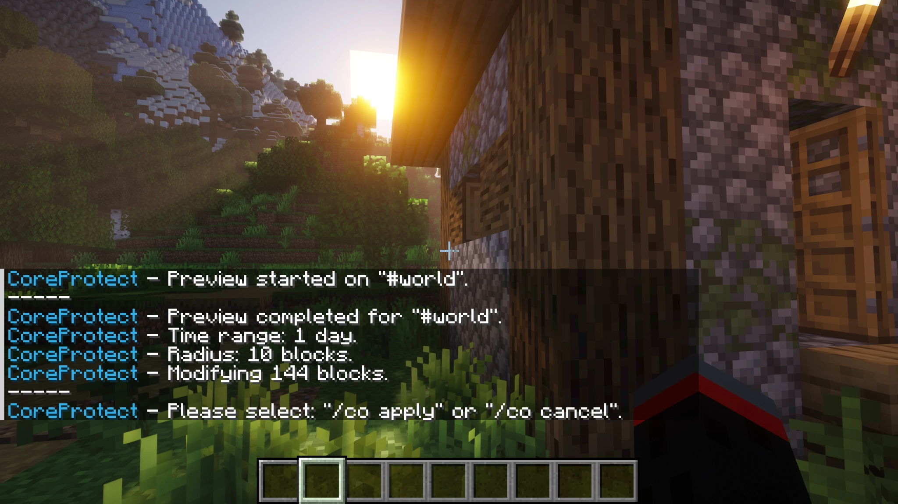
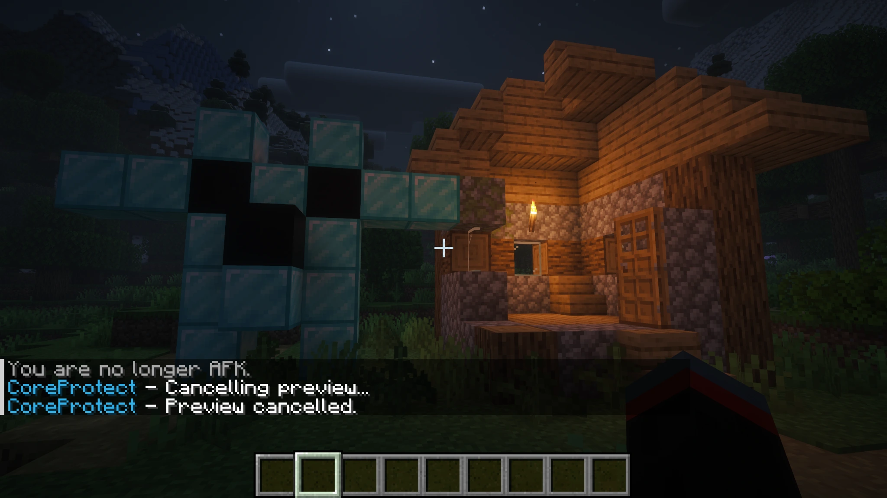
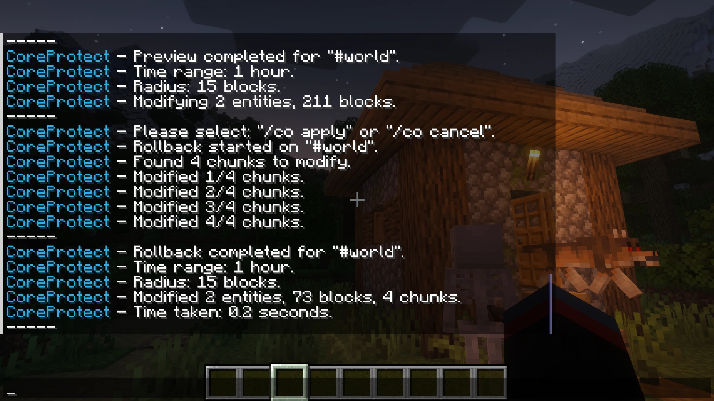
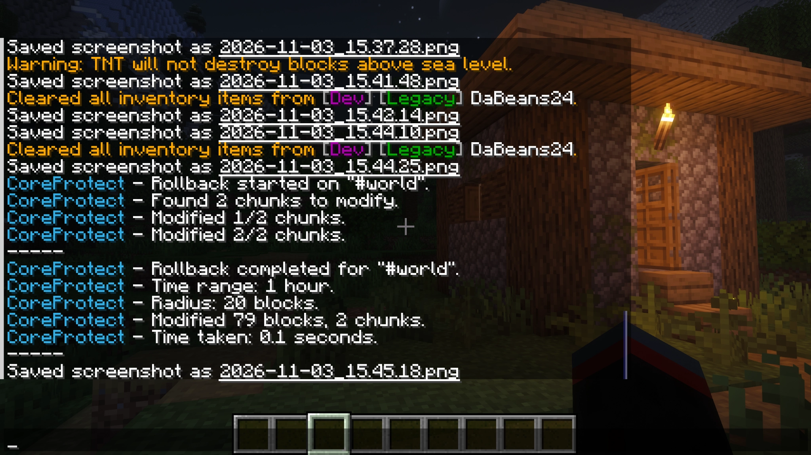
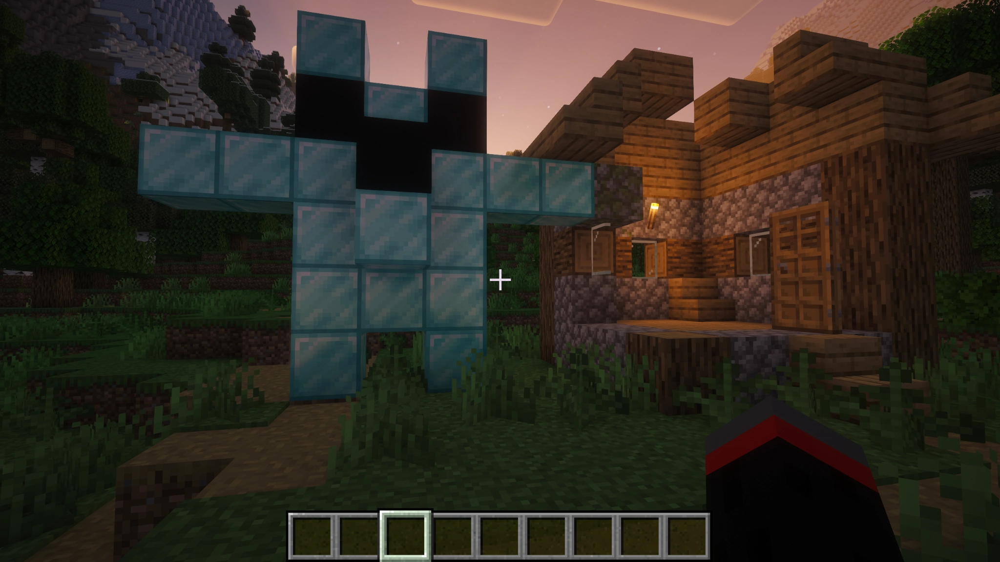
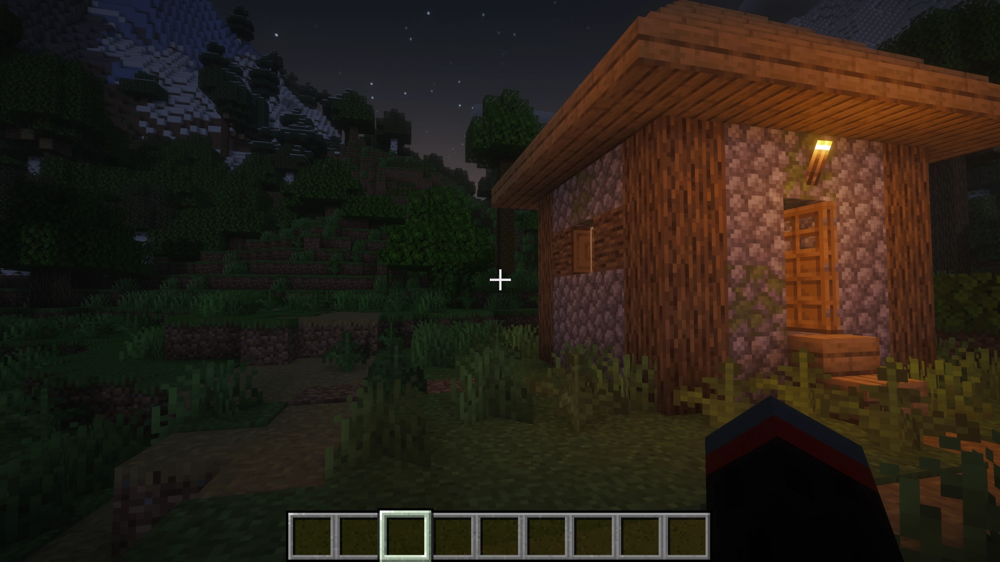

---
tags:
  - ADMIN
  - DEV
  - SERVER LEAD
---

# Module 3 · Land & Build Restoration

After verified griefing or accidental damage, Admins may need to restore parts of the world. A poorly scoped rollback can undo legitimate player work. This module focuses on **land and building corrections**; missing inventory items are covered separately in [Module 4](mod4.md){ data-preview }.

---

## When Land Restoration Is Appropriate

Before restoring anything, determine what was actually lost and why.

Restoration may be appropriate when:

- A confirmed rule violation caused damage to a structure or protected area.
- Staff or a server issue accidentally changed player property.
- A documented correction is necessary to repair an earlier staff action.

Restoration is not automatic for ordinary gameplay losses or disputed ownership. If the complaint concerns missing inventory items, continue to [Module 4](mod4.md){ data-preview }.

For griefing and theft, use [Section 3.2.7](../../documentation/standard-procedures.md#327-griefing-or-theft){ data-preview } to determine what can reasonably be restored.

!!! important "Investigate before restoring"
    Preserve the evidence first. Once blocks have been changed, it may be harder to reconstruct the original event.

---

## Restoring Builds With CoreProtect

A **rollback** reverses logged changes. A **restore** can reapply changes that were rolled back. These tools are helpful for griefing, but the wrong time, account, or area can undo legitimate work too.

### Example: A Damaged House

A Moderator has escalated a report of a broken wall. CoreProtect shows `ExamplePlayer` broke the wall, **but also legitimately built a porch nearby during the same hour**. Start beside the damaged wall. We need to recover the wall without undoing the porch.

**1. Review the actual changes.**

```text
/co lookup u:ExamplePlayer t:1h r:10 a:block
```

Check which blocks were placed or broken, when, and where. This first search includes both the wall damage and legitimate porch changes by the **same account**. Write down which entries are actually related to the griefing.

**2. Preview the correction.**

```text
/co rollback u:ExamplePlayer t:1h r:10 a:block #preview
```

The `#preview` option lets you inspect the proposed result before committing a rollback. On ERRSA's tested CoreProtect 23.0 setup, a pending preview can show **`Please select "/co apply" or "/co cancel".`** That is a decision prompt, **not approval** to change the world.

Check the affected blocks in the world, the number of matches, and any messages returned. **A preview completing successfully does not mean the selected changes are safe.** A preview showing **0 matching blocks** may mean your filters missed the damage; a unexpectedly large preview (such as the **1,007-block result** seen during training) is a reason to stop and review the scope, not to press Apply.

The **damaged wall and legitimate porch** above are a hypothetical training case. The screenshot below comes from a **separate ERRSA test**: it demonstrates the preview message and confirmation options, not that a porch was selected.



*Real ERRSA preview: **1 day**, **10-block radius**, **144 selected blocks**. CoreProtect asks for `/co apply` or `/co cancel`. The number alone does not tell you whether those changes are appropriate.*

**In the hypothetical wall-and-porch case**, a preview that includes the legitimate porch is **not acceptable**, even if it completed successfully. **Cancel that pending preview:**

```text
/co cancel
```



*CoreProtect responds **“Cancelling preview…”** and **“Preview cancelled.”** This confirms that the pending selection was discarded; it does not change the world. The preview is no longer waiting to be applied.*

If the grief involved only blocks they **broke**, a narrower option to investigate is:

```text
/co lookup u:ExamplePlayer t:1h r:10 a:-block
/co rollback u:ExamplePlayer t:1h r:10 a:-block #preview
```

That excludes placed blocks, but can still catch unrelated blocks the same account legitimately broke. Compare the new selection to the verified damage. If the results are still mixed or you cannot tell what the preview would affect, **cancel and ask another Admin to review it**.

**Acceptable preview:** only confirmed damage is selected, with the correct area and time. **Reject the preview** when legitimate work, an incorrect world, or unexplained changes are included. A successful preview message is not approval.

**3. Confirm or cancel the pending preview.**

If the exact pending preview has been checked, is limited to verified damage, and the restoration is authorized, use the option shown by CoreProtect:

```text
/co apply
```

The next screenshot is **another separate ERRSA test**, showing how the output changes after a pending preview is applied. It is not the fictional porch case or the 144-block preview above.



*In this test, the preview listed **211 blocks and 2 entities** within a 15-block radius. The completed rollback reported **73 blocks and 2 entities** modified across 4 chunks.*

**Why do the counts differ?** The screenshot alone cannot establish the reason. A preview shows proposed matches and the final output shows reported modifications. Check the world and seek a second review of unexpected changes; do not invent an explanation from counts alone.

If it is too broad, wrong, unclear, or **0 blocks** when you expected damage, do **not** apply it. Use:

```text
/co cancel
```

Then review the evidence and start a **new**, narrower preview if needed. Do **not** automatically rerun the rollback without `#preview` while a preview is pending. These confirmation commands reflect the behavior observed on ERRSA; if the server presents a different prompt, stop and verify rather than guessing.

**4. Inspect the wall again.** Confirm the missing blocks returned, nearby player work was not changed, and nothing remains unresolved. Record the selected filters, preview, decision, and result in the incident record.

### What a Completed Rollback Does, and Doesn't, Prove

The completion message confirms that CoreProtect changed blocks or entities. It does **not** confirm that the right property was restored. Always walk the affected area and compare the outcome with the original report.

### Example: Verifying Before and After

This separate ERRSA training example recorded **79 blocks changed across 2 chunks**. It is unrelated to the 144-block and 211-block screenshots above.



**Before:**



**After:**



CoreProtect confirms that blocks changed, not whether removing them was appropriate. Compare the results to the verified report and seek a second review if you cannot explain a difference.

For large or complex corrections, ask a Developer or Server Lead to review the scope. If a rollback was incorrect, preserve what happened and get help before attempting `/co restore`; blindly reversing commands can make the issue worse. See the [CoreProtect command reference](https://docs.coreprotect.net/commands/){ target="_blank" }.

---

## Accidental Damage & Large Repairs

An approved event, staff WorldEdit mistake, or plugin problem can also require a documented correction. Limit small verified repairs to the affected area. Large edits, shared structures, world backups, and server-wide changes belong with a Developer or Server Lead. Do not make a world-wide restoration independently.

## Recording the Restoration

Record the report, evidence, exact world/region, CoreProtect filters, preview decision, approval, actual changes, and unresolved questions in the incident record. Verify nearby legitimate builds were not altered.

## Check Your Understanding

A verified griefing report includes nearby legitimate construction by the same player. Your first rollback preview selects both. Should you apply it?

??? tip "Suggested approach"
    No. Use `/co cancel`, narrow the query and preview again, and seek a second review if you still cannot isolate the damage. Never apply a preview that includes legitimate work.

---

<nav class="handbook-next" aria-label="Continue reading">
  <a href="../mod4/">
    <span class="handbook-next__copy"><small>Next section</small><strong>Module 4 · Item & Inventory Recovery</strong><span>Learn how to verify missing items without duplicating property.</span></span>
    <span class="handbook-next__arrow" aria-hidden="true">→</span>
  </a>
</nav>
