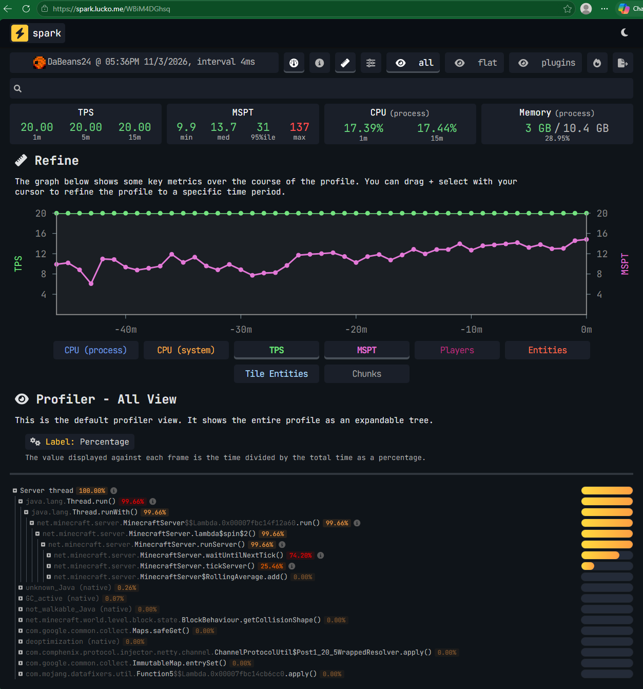

---
tags:
  - ADMIN
  - DEV
  - SERVER LEAD
---

# Module 5 · Server Operations

Admins also help with basic server health checks, connection issues, and operational incidents. The goal is to identify **what is affected** and provide usable information, not to make random changes until the issue disappears.

These responsibilities are about monitoring and supporting operations. Plugin development, configuration changes, and major infrastructure work remain Developer or Server Lead responsibilities.

---

## Understanding the Server Environment

ERRSA uses a Minecraft network with a Velocity proxy and backend servers. A problem affecting one world or backend may not be the same as a problem preventing every player from connecting.

When something stops working, identify the scope before acting:

- **One player:** Could be a client, account, permission, or connection issue.
- **One command or plugin feature:** Could be a plugin, permission, or configuration issue.
- **One world or backend:** Could be world-specific settings or a backend problem.
- **The entire network:** May involve the proxy, hosting service, or a broader outage.

Knowing the scope helps the technical team look in the right place and prevents unnecessary changes to unaffected services.

---

## The Server Console

The console displays live server messages, startup and shutdown activity, command output, warnings, and errors.

Some Admins may have console or log access through [Apex Hosting](../../tools/apex-hosting/index.md){ data-preview }, depending on their assigned account access. In-game permissions do not themselves grant access to the host panel.

When reviewing console output:

1. Note the server you are viewing and the approximate time of the issue.
2. Look for the first relevant warning or error, not simply the last line displayed.
3. Identify the plugin, command, world, or player involved if the output indicates one.
4. Compare the error time with the reported behavior.
5. Preserve a relevant excerpt or restricted reference for the Developer if escalation is needed.

!!! tip "One error may cause several more"
    A single plugin or dependency failure can produce many follow-up messages. Focus on when the problem started and what happened immediately before it.

Do not share console output containing addresses, tokens, secrets, or other private information in public channels.

---

## What Is spark?

**spark** is the performance-monitoring plugin used on ERRSA to inspect server health. `/spark tps` displays tick-rate measurements; `/spark health` provides a broader health summary. A web profiler report can show sampled activity over time, but reading its internal profiler tree is generally a Developer task. These tools diagnose performance; they do not automatically prove a particular player or plugin caused lag.

---

## Understanding TPS & MSPT

Minecraft runs in short updates called **ticks**. A healthy server aims for **20 ticks per second (TPS)**. **MSPT** means milliseconds per tick, or how long the server takes to process each update. To keep up with 20 TPS, a tick has a budget of about **50 milliseconds**.

For example:

| Reading | What it means |
| --- | --- |
| **20 TPS, 20 MSPT** | The server is keeping up. Look for other causes if players still report a problem. |
| **13 TPS, 75 MSPT** | The server is falling behind; there may be a server-side performance issue. |
| **20 TPS with occasional spikes** | A short spike is not automatically a crisis. Look for repeated or sustained issues. |

TPS and MSPT do not automatically tell you *what* is causing lag. Player ping, client FPS, and connection issues can also make the game feel slow even if TPS is normal.

### Real ERRSA spark Example

*Actual ERRSA spark web profiler report from November 3, 2026. This is the report opened in a browser, not the in-game chat output from `/spark tps`.*

Here's what an Admin should notice:

- **TPS:** The 1-, 5-, and 15-minute readings all show **20.00 TPS**. The server was maintaining its target tick rate over those periods.
- **MSPT:** The median is **13.7 ms**, and the 95th-percentile reading is **31 ms**, both below the 50 ms tick budget. The **137 ms maximum** indicates at least one longer tick, but does not establish ongoing lag by itself.
- **Graph:** The green TPS line stays at 20 while the purple MSPT line changes. Look for sustained problems instead of treating one spike as the cause of a report.
- **CPU and memory:** The report shows roughly **17% process CPU** and **3 GB of 10.4 GB process memory**. These help describe the server's condition, but do not identify which plugin or activity caused a delay.

!!! tip "Reading the profiler below the graph"
    The **Server thread 100%** entry is a percentage within the profiler's sampled work, **not** a claim that the server's CPU is running at 100%. Admins generally only need the readings above the graph and a link to the report when escalating. Developers can investigate the detailed profiler tree.

The useful question is whether poor readings continue over time, not whether you can find one unusually high number. `/spark tps` is a starting point; it cannot by itself identify which plugin, farm, or player caused a problem.

---

## Quick Server Checks

Admins use the following confirmed ERRSA diagnostic commands when gathering information for the technical team:

| Command | When to use it |
| --- | --- |
| `/spark tps` | See TPS and tick-performance measurements when players report lag. |
| `/spark health` | View the server's wider health report, including resource usage. |
| `/mclogs` | Upload the current server log and generate a link for an approved investigation. |
| `/mclogs list` | List available server logs, crash reports, and network protocol error reports. |
| `/servers` | Open the ERRSA server menu and check which backend you can reach. |

`spark` gives you useful measurements; you do not need to run a profiler or interpret CPU traces by yourself. Record the affected backend, when the problem began, and the readings while it is happening. See the [spark command guide](https://spark.lucko.me/docs/Command-Usage){ target="_blank" } for details.

### Example: Players Report Severe Lag

1. Ask whether everyone is affected or only one player or world. Check whether the player means low FPS, delayed interactions, or trouble connecting.
2. Run `/spark tps` on the affected backend. If TPS is low or MSPT is consistently high, note the figures and time.
3. Use `/spark health` for additional context and identify what changed recently (for example, an event, new farm, or many players joining).
4. Send the findings to a Developer if the cause remains unclear or the problem is serious. Do not start deleting entities or dismantling builds based only on a low-TPS reading.

### Checking Logs

Admins have access to **mclogs** on ERRSA, including `/mclogs` and `/mclogs list`. It helps you collect the right log when a player reports a crash, a command error, or another technical problem.

- Use `/mclogs` when you need the **current server log**. It uploads that log and gives you a link to share with the appropriate staff.
- Use `/mclogs list` when the issue happened earlier. It shows available logs and reports so you can identify what might contain the error. **Listing a file does not upload it.**

Before sharing anything, make sure you're checking the correct backend and note approximately when the problem occurred. Give the Developer the relevant time, symptoms, and log reference rather than asking them to search blindly.

!!! warning "Logs may contain private information"
    `/mclogs` uploads a log to an external website. Automatic filtering does not guarantee that every sensitive detail is removed. Only upload logs when appropriate for the investigation, and share the resulting link with authorized staff, not in public Discord channels. If an older log needs to be shared, coordinate that with a Developer.

---

## Restarting & Maintaining Servers

Restarts interrupt active gameplay and may disrupt events or recovery work. **Admin permissions are not blanket restart authority.** Confirm approval and coordinate any planned maintenance with the appropriate staff.

Before an authorized restart:

- Confirm which server needs attention and why a restart is necessary.
- Check whether a Developer or another staff member is already working on it.
- Coordinate a player notice when needed.
- Make sure no event, update, or recovery process will be interrupted.
- Record the reason, time, and outcome when the restart is significant.

Afterward, verify that players can reconnect and that the affected feature actually works.

!!! warning "Avoid improvised fixes"
    Do not run `/reload` (including plugin-specific reloads), delete plugin files, repeatedly restart a crashing server, or change live configuration in hopes of fixing an unknown error. These can make the issue harder to diagnose or cause additional damage.

---

## Recognizing Common Operational Problems

| Symptom | Useful first check | Next step |
| --- | --- | --- |
| Players cannot join | Determine whether it affects one player, one backend, or the network. | Escalate proxy or backend errors to a Developer. |
| Server feels laggy | Note when it started, which world is affected, and whether a farm or event is involved. | Report relevant observations; do not disable systems at random. |
| A command suddenly stops working | Compare roles, contexts, recent changes, and plugin status. | Investigate permissions or refer to the Developer. |
| A plugin reports errors | Preserve the relevant log lines and timing. | Developer reviews the underlying issue. |
| Server crashes | Follow the crash procedure immediately. | Developer or Server Lead coordinates recovery. |

The [Troubleshooting](../../troubleshooting/index.md){ data-preview } section and tool pages provide additional reference information.

---

## When to Stop & Escalate

Some problems are beyond the intended scope of Admin access, including:

- Editing plugin or network configuration files.
- Changing databases or credentials.
- Installing, updating, or removing plugins.
- Restoring backups or performing server-wide rollbacks.
- Repeated crashes, unexplained corruption, or widespread connection failures.

You can still help by collecting symptoms, preserving evidence, and coordinating player communication. Under the [server crash procedure](../../documentation/standard-procedures.md#321-server-crashes){ data-preview }, a Developer or Server Lead handles the technical response and public announcement if downtime continues beyond 15 minutes.

---

## Check Your Understanding

Two players in Survival report block delays, but another player reports only low FPS. You run `/spark tps` and see low TPS. What should you record, and what should you avoid doing?

??? tip "Suggested approach"
    Record the affected server, time, TPS/MSPT readings, and what players experienced. The low FPS may be a separate client problem. Escalate with those findings instead of randomly clearing entities or restarting the server.

---

<nav class="handbook-next" aria-label="Continue reading">
  <a href="../mod6/">
    <small>Next section</small><strong>Module 6 · Claims, Worlds & Player Management</strong>Learn how claims, plots, and protected worlds affect player issues.
    →
  </a>
</nav>
