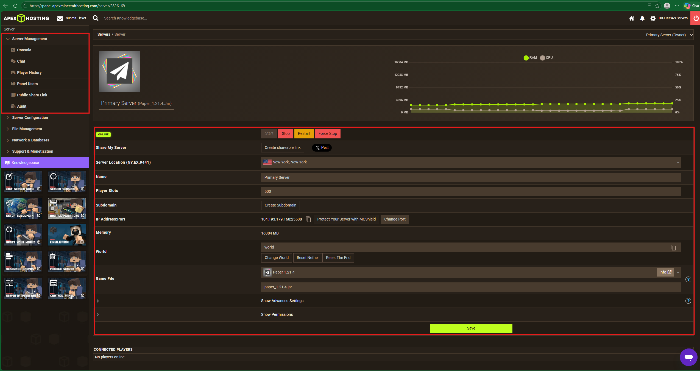
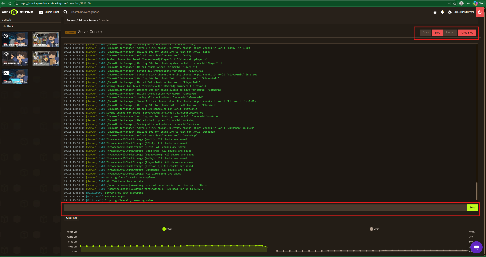
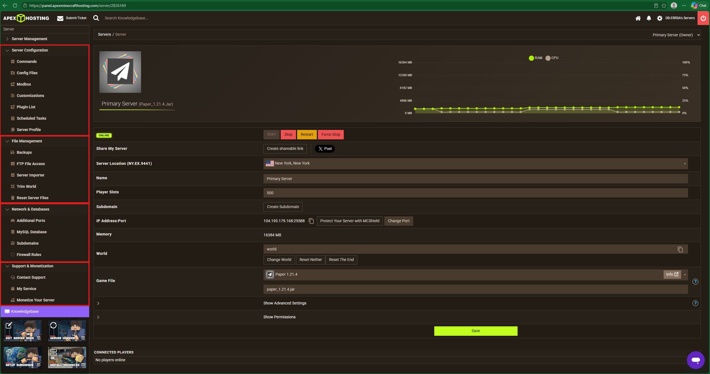

---
tags:
- DEV
- SERVER LEAD
---

# Module 1 · Server Architecture

Players experience ERRSA MC as one Minecraft server, but behind the scenes it is a network of several servers, plugins,
and connected services. Developers need to know where each system runs, how the systems interact, and what a change 
might affect before working on them.

This module introduces that architecture and provides a practical tour of Apex Hosting, the control panel Developers 
will use regularly. It is not a guide to installing plugins, modifying databases, or fixing every error. Those skills 
are covered in later modules.

!!! info "Before you begin"
You should already have completed [Server Fundamentals](../fundamentals/intro.md){ data-preview }, including the basic
overview of ERRSA's worlds, servers, and player-facing systems. You do not need to have completed Admin training 
to follow this module.

By the end, you should be able to:
- Identify the proxy and three Paper backends, and explain what each one does.
- Find the major Apex controls and distinguish the controls that provide information vs those that will make production changes
- Recognize the difference between a server, a world, a plugin, and a shared service.
- Explain where Java and Bedrock connections enter the network.
- Identify which systems a change or failure could affect, and when approval is required.

## The ERRSA MC Network

ERRSA uses four hosted server instances: one Velocity proxy and three Paper backends. A server instance is a separately
managed running service with its own configuration, files, and console. Multiple Minecraft worlds can exist inside one Paper backend.


| Server | Software | Main purpose                                                                                                  |
| --- | --- |---------------------------------------------------------------------------------------------------------------|
| **Proxy** | Velocity | Receives player connections and routes them to the specified backend.                                         |
| **Primary** | Paper | Hosts the main Survival experience and other worlds, including Creative and Legacy Lake.                      |
| **Events** | Paper | Hosts activities and events separately from Primary.                                                          |
| **Testing** | Paper | Mirror of the Primary Server providing a controlled place to test changes and investigate technical problems. |

Follow a player's connection: 

> 1. A Java player connects to the ERRSA address
> 2. reaches Velocity
> 3. sent to the 
appropriate Paper server. 
>
> If the player later moves from Primary to Events, Velocity handles the transfer. 
> 
> If the player in Primary moves from Survival world to Creative world Velocity doesn't handle the transfer because the player is staying
> within the same server.


## Apex Hosting

[Apex Hosting](../../tools/apex-hosting/index.md){ data-preview } provides the hosting infrastructure and management 
panels used for ERRSA's Minecraft servers. Instead of the committee maintaining the physical hardware, Apex
hosts the instances and provides tools for controlling processes, managing files, observing resource usage, arranging
backups, and contacting support.


### The Network Dashboard

 

The dashboard lists the servers your Apex account has permission to access. Select the correct instance before doing 
anything else. A console command, uploaded file, restart, or scheduled task normally applies to the instance you have 
selected, not automatically to the entire network.

ERRSA has separate hosting packages for the proxy and each backend. Primary has a larger resource allocation because it 
supports the main player activity, while Events and Testing generally need fewer resources. Currently, Primary is hosted 
in New York while the other instances are hosted in Miami. Packages, resource allocations, and locations may change.

!!! tip "Apex resource graphs"
The panel will show memory and CPU information. These help you observe whether a server is running and how it is using 
its allocated resources, but high usage alone does not tell you which plugin or player caused a problem. 
More detailed diagnosis is in [Module 5](mod5.md).

### Understanding the Server Panel

Selecting a server opens its dedicated control panel. Its main screen provides a status overview, common controls, 
and server settings.



| Panel item | What it means                                                            | Developer consideration                                                                                                                          |
| --- |--------------------------------------------------------------------------|--------------------------------------------------------------------------------------------------------------------------------------------------|
| **Start / Stop / Restart** | Controls the selected server's process.                                  | Interrupts service; coordinate and get approval when required. A normal stop or restart attempts orderly shutdown, but does not replace backups. |
| **Force Stop** | Terminates an unresponsive process without waiting for a normal shutdown. | Higher risk to unsaved data; use only when authorized and necessary.                                                                             |
| **Server Location** | The hosting region for that instance.                                    | Can affect latency and connectivity. Do not move an instance casually.                                                                           |
| **Name** | The label used to identify the instance in Apex.                         | Confirm it matches the server you intend to manage.                                                                                              |
| **Player Slots** | The configured player limit.                                             | Not a measurement of how many players the hardware can support comfortably.                                                                      |
| **IP Address:Port** | The network endpoint of the selected instance.                           | Used when connecting servers to the proxy.                                                                                                       |
| **Memory** | The resource allocation shown for the server.                            | Not the same thing as current memory use.                                                                                                        |
| **World** | The configured default world name.                                       | Will change the default world that spawn is on                                                                                                   |
| **Game File** | The server software                                                      | Changing it will change the Minecraft version and/or server behavior.                                                                            |

!!! danger "Not everyday settings"
Do not change the server location, IP/port, default world, game file, or advanced startup settings without explicit 
approval from the Server Lead. Some are normally changed only when setting up, migrating, or resetting a server. 
A wrong change can prevent players from joining, corrupt current files, or make a server start with unexpected files.

### Server Management

This area contains the tools for observing the server and managing approved access.

| Option | Purpose |
| --- | --- |
| **Console** | Shows live startup messages, commands, warnings, and errors. Authorized staff can also send commands directly. |
| **Chat** | Displays player chat information available to the panel. |
| **Player History** | Helps identify connections and attempted connections to the selected instance. |
| **Panel Users** | Controls or displays which people have panel access and their assigned permissions. |
| **Audit** | Shows recorded panel activity, helping staff review who performed actions and when. |



The Console is particularly important. A Developer may use it to confirm that a server started, identify the first 
meaningful error, or observe a command's result. A console command may have more authority than the same command used 
in-game, and should be used only when needed.

!!! warning "Console and audit data may be sensitive"
Logs, command output, and panel records can expose player information or internal infrastructure. 
Do not post them in public channels. Use approved staff communication and redact credentials or private information.

### Server Configuration:



| Option | Purpose |
| --- | --- |
| **Config Files** | Gives access to selected settings and files through the panel. |
| **Customizations** | Exposes server launch options and additional gameplay or hosting settings. |
| **Scheduled Tasks** | Runs configured commands or maintenance actions automatically at specified times or intervals. |
| **Server Profile** | Shows additional server-specific configuration and management options. |

Scheduled tasks are convenient, but they can repeatedly run a bad command without anyone watching. Developers should 
know these functions exist; creating tasks, installing plugins, or editing configuration is covered in later modules and 
requires the appropriate authorization.

### File Management & Backups

Most changes Developers make involve files. This section is especially important because mistakes here can
affect live worlds, plugin data, or the server's ability to start.

| Option | Purpose |
| --- | --- |
| **Backups** | Shows backup and restoration options available for the selected instance. |
| **FTP File Access** | Provides access to the server file structure for browsing, downloading, editing, or transferring files. |

The Apex file manager is convenient for inspecting individual files. For larger transfers, an approved desktop 
file-transfer client such as FileZilla can be easier to use. The connection protocol and credentials must match what 
Apex provides. Detailed file editing, safe transfers, and plugin changes are located in [Module 2](mod2.md).

A Paper server commonly includes files such as server.properties, bukkit.yml, spigot.yml, config/, plugins/, logs/, 
and world folders. The proxy has its own files and plugins; uploading a Paper plugin to the proxy does not make it run 
on the Paper backends.

!!! warning "Backups are not interchangeable"
Check what a backup actually contains before relying on it. ERRSA's existing procedure describes routine Apex panel 
backups as world-focused, rather than full copies of all plugin data. Do not assume the selected backup also contains 
plugins/, databases, or every configuration file. ERRSA has previously needed Apex support to recover additional server 
files; such recovery is not guaranteed (especially with large files). A restore will overwrite newer data, so use this 
as last option if the risk is justifiable.

!!! danger "Production file access"
Deleting a plugin folder, replacing a world, resetting server files, or restoring a backup may permanently remove player progress or configuration. Do not use production as a practice environment. Make approved changes in Testing first and coordinate any production deployment.

### Network & Databases

| Option | Purpose                                                                                                 |
| --- |---------------------------------------------------------------------------------------------------------|
| **Additional Ports** | Allocates additional network ports when required by approved services, such as voice chat or map tools. |
| **MySQL Database** | Provides database resources used by plugins or other connected systems.                                 |
| **Subdomains** | Manages server address configuration only matters for the proxy where it's set at ```errsa.mc.gg```        |

These tools connect Apex to the wider architecture. A database can be used by more than one server or service. 
The details of SQL and external integrations are located in [Module 4](mod4.md).

### Support & Monetization

Apex includes Contact Support and account/service management options. Apex support can help with hosting-level issues 
and certain recovery requests; coordinate important tickets with the Server Lead so the team knows what is being 
requested. Other account and monetization features are **not** general Developer responsibilities.

!!! info "What you should know about Apex after this module"
You should be able to find the right server, read its status and console, identify where files and backups are managed, 
and recognize which settings could impact production. Knowing where a button is does not authorize pressing it.

---

## Velocity: The Network's Entry Point

Velocity is the proxy software running in front of ERRSA's three Paper backends. It accepts incoming player connections, 
manages network routing, and forwards connection information to backends under the network's configured security model. 
Velocity and Paper are projects in the PaperMC ecosystem, but they serve different jobs.

For example, 

>A player joins ERRSA and is routed to Primary. Later, the player uses the server menu to join Events. 
> 
>Velocity manages the connection between these backend servers. It does not simulate any Minecraft worlds or run Paper-only plugins.

The proxy is also an important security boundary. Backend servers are not intended to serve as alternative public entry 
points; they rely off of the proxy by appropriate hosting network protections and forwarding configuration. 
Velocity uses forwarding secrets which is highly sensitive and must not be shared. 

### Typical Velocity Files

| Item | Purpose |
| --- | --- |
| `velocity.toml` | Main proxy configuration, including server definitions and connection behavior. |
| `forwarding.secret` | Secret used by the configured player-information forwarding method. Keep it private. |
| `plugins/` | Proxy plugin `.jar` files and their configuration folders. |
| `logs/` | Proxy logs. |
| Velocity executable `.jar` | Starts the proxy process; the actual filename may vary. |

!!! tip "Why the proxy matters during an outage"
If players can join Primary but cannot transfer to Events, some parts of the connection path are already working. If
nobody can reach any backend, the proxy and shared network components become more relevant. This does not identify the 
cause by itself; it tells you where to start looking.

---

## Paper: The Backend Servers

Paper runs Minecraft gameplay. It loads worlds, processes player actions and entities, and runs the plugins that provide most in-game features. ERRSA uses separate Paper instances for Primary, Events, and Testing.

A backend server is not the same as a world:
- One backend can contain several worlds, such as Survival, Creative, and Legacy Lake are all on Primary.
- Each backend has its own process, console, startup settings, logs, installed plugin files, and local world files.
- Separate backend files do not guarantee separate external data. Two instances could still connect to the same database, service, or permission system if configured that way.
  
### Typical Paper Files

| Item | Purpose |
| --- | --- |
| `plugins/` | Installed Paper plugins and their local data/configuration folders. |
| `logs/` and `crash-reports/` | Operational output and crash reports when produced. |
| World folders | Terrain, player/world information, and related world files. |
| `config/` | Paper-specific configuration, including global and default world settings. |
| `server.properties`, `bukkit.yml`, `spigot.yml` | Core Minecraft and server-software settings. |
| Paper executable `.jar` | The backend software; the selected version controls the Minecraft server version. |

!!! example "Why Testing exists"
A trainee Developer changes a plugin on Testing and the server fails to start. If Testing is properly isolated, 
Primary should remain running and its local files should be untouched. But if Testing points at a production database or 
shared service, the change could still affect live data. Always check dependencies before assuming a test is harmless.

---

## Plugins, Data & Connected Services

Plugins add capabilities to Velocity or Paper without changing Minecraft's original source code or requiring all players to install a client-side mod. They are generally distributed as .jar files and may have their own configuration and data folders.

> Examples already used on ERRSA include:
>
> - [EssentialsX](../../plugins/server-and-infrastructure/essentials.md){ data-preview } for common commands
> - [GriefPrevention](../../plugins/permissions-and-moderation/griefprevention.md){ data-preview } for claims
> - [CoreProtect](../../plugins/permissions-and-moderation/coreprotect.md){ data-preview } for activity records
> - [LuckPerms](../../plugins/permissions-and-moderation/luckperms.md){ data-preview } for permissions

Not every plugin affects the same area:

| Scope | Example of what it means |
| --- | --- |
| **One Paper backend** | A plugin installed only on Primary changes behavior there. |
| **Proxy** | A Velocity plugin can affect connections or network-level behavior. |
| **Multiple servers through shared storage** | Services using the same database may read or modify common data. |
| **External service** | A Minecraft plugin may exchange information with Discord, SQL, Power Automate, or a hosted web service. |

Some plugins integrate with other plugins on the same server through their APIs. Others communicate across a network or 
through shared storage. Installing a plugin on several backends does not automatically make their data synchronized, and
separating plugin folders does not automatically isolate their databases.

For example, ERRSA's PlayerInitialization system interacts with external registration services. At this stage, 
Developers only need to recognize that an in-game feature can depend on components outside the Paper server. The complete 
PlayerInitialization flow comes in [Module 6](mod6.md); plugin dependencies and configuration are covered in [Module 2](mod2.md).

!!! important "Check the actual connection before changing data"
Never assume a database belongs only to Testing or that LuckPerms permissions apply only to the backend where you are 
standing. Verify the applicable server, storage configuration, and permission context first. Permission management is 
covered in [Module 7](mod7.md).

---

## Minecraft Versions & Player Compatibility

There are three different kinds of 'Java version' that Developers should keep distinct:

| Term | Meaning |
| --- | --- |
| **Minecraft Java Edition version** | The Minecraft protocol and features used by a Java client, such as Minecraft 1.21.4 or a newer release. |
| **Paper server version** | The Minecraft release supported by the Paper executable running a backend. |
| **Java runtime (JVM) version** | The programming runtime used to execute Paper, Velocity, and many plugins. This has its own version requirements. |

A plugin can be compatible with the Minecraft server version but incompatible with its Java runtime, or vice versa. More 
detailed compatibility checks come in [Module 2](mod2.md).

### Java Edition: ViaVersion

ERRSA uses ViaVersion to help supported newer Java Edition clients connect to an older Minecraft server version. On 
ERRSA, ViaVersion is installed on Velocity. It works with network protocol compatibility; it does not upgrade the 
backend's actual gameplay features to the player's client version, rather it translates to the server version.

> For example, a compatible newer Java client may be able to join a Paper 1.21.4 backend through ViaVersion, but that 
> backend still runs 1.21.4 gameplay. A client-version update can introduce temporary compatibility issues until the 
> supporting plugin is updated.

### Bedrock Edition: Geyser & Floodgate

ERRSA also supports Bedrock players through two related tools:
- Geyser translates the Bedrock protocol so players can connect to the Java-based network.
- Floodgate supports Bedrock account access without requiring each Bedrock player to own or authenticate using a Java Edition account.
  ERRSA runs the connection-facing components at the proxy, with additional backend Floodgate functionality where 
needed. The precise placement matters when using backend integrations or Floodgate's API. This is a connection and 
identity system, not just a version converter.

!!! note "Compatibility has limits"
ViaVersion, Geyser, and Floodgate make cross-version or cross-edition connections possible, but they cannot guarantee 
identical behavior for every mechanic, item, skin, plugin feature, or client release. Investigate the affected connection 
path before assuming Paper itself is broken.

---

## Scope, Safety & Developer Responsibility

Architecture matters because a Developer can accidentally affect more than the system currently being worked on.

| Change or failure | Potential scope |
| --- | --- |
| A world configuration change on Primary | A particular world or gameplay feature on Primary. |
| A Paper plugin failure on Events | Events players and features depending on that plugin. |
| A Velocity routing or forwarding change | Connections or transfers across multiple backends. |
| A shared database or permission change | Every connected server or service using the affected data. |
| An Apex stop, reset, or file restore | The selected instance and any systems depending on it; a restore may overwrite later data. |

Before changing anything, establish which instance you are accessing, what the change touches, whether it depends on shared resources, and who has approved it.

!!! danger "Access is not authorization"
A Developer's technical permissions may allow broad changes, but production actions still require judgment and the 
approvals defined by ERRSA leadership. Protect credentials, document approved changes, and stop to ask when the impact is uncertain.

---

## Check Your Understanding

1. One backend or the whole network? A player can connect to Primary but receives an error when transferring to Events. 
Is the entire ERRSA network necessarily offline? What systems would you investigate first?

??? tip "Suggested approach"
No. The player reached the proxy and at least one backend. Begin with the Events backend's status and logs, Velocity's 
Events routing configuration, and relevant connection or permission errors. Do not restart Primary without evidence that it is involved.

2. Separate servers, shared data. You are testing a LuckPerms change on Testing. The Testing server has its own plugin 
files. Does that guarantee the change cannot affect Primary?

??? tip "Suggested approach"
No. Local files are separate, but storage, proxy permissions, and other dependencies may be shared. Check the actual
storage configuration, contexts, and scope before modifying permissions.

3. The Apex panel. You open the wrong server in Apex and see a configuration option that might fix a reported issue. 
What should you do before using it?

??? tip "Suggested approach"
Confirm the correct instance and impact, identify the relevant file or setting, check authorization and the required 
backup/test plan, and coordinate with the Server Lead as appropriate. Knowing how to use the setting does not make an 
unapproved production change safe.
___

!!! success "Module 1 complete"
You should now understand where ERRSA's major systems live, how they connect, and what a Developer can affect through 
Apex. The next module covers plugins in more detail, including compatibility, dependencies, configuration, 
file transfers, and safe updates.
<nav class="handbook-next" aria-label="Continue reading">
  <a href="../mod2.md">
    <span class="handbook-next__copy"><small>Next section</small><strong>Module 2 · Plugins</strong><span>Learn how 
plugins fit together and how to manage them safely.</span></span>
    <span class="handbook-next__arrow" aria-hidden="true">→</span>
  </a>
</nav>