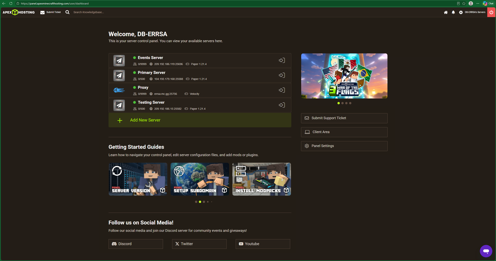
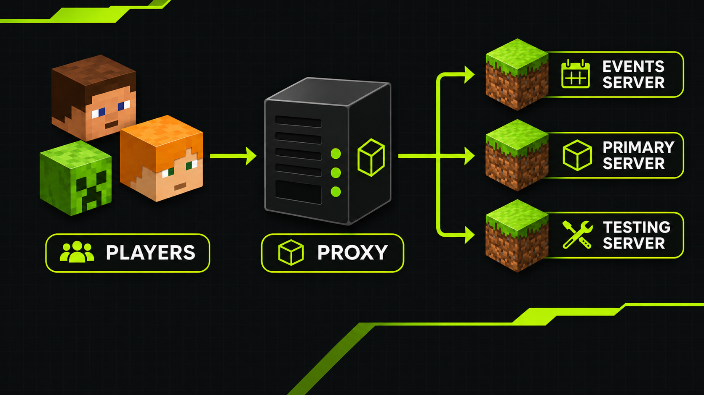

---
tags:
- DEV
- SERVER LEAD
---

# Module 1 · Server Architecture

Developers provide are the engineers behind the scenes keeping this server playable for all. With this major
responsbility, Developers are expected to understand the architecture running this server.

## Apex Hosting
 
Apex Hosting infrastructure (structure of UI & Overview)
Hosting MC servers requires the server to be run on physical hardware for multiplayer connection. MC Servers are usually
run on a physical server (most optimal) or on a computer. For the ERRSA MC server, we use [Apex Hosting's](../../tools/apex-hosting){ data-preview } 
equipment which comes with a control panel full of useful options (explained more below), runs on data center hardware with
automated backups and DDoS protection, among other useful perks that comes with a subscription.

Apex also provides a support team so do not be afraid to submit a ticket for relevant situations!

### ERRSA MC Network

Apex allows us to manage our MC network through an integrated dashboard. Our MC network includes a proxy server and 
three actual minecraft servers. Each server requires an individual subscription package:

!!!Note "Each server may have differences in performance" We currently pay extra to provide extra performance to the 
"Pimary Server" do to the player usage. Whereas the "Testing Server" and "Events Server" are smaller packages due to not
needing the same ammount of perfomance capabilities, enabling us to save substantial money.

 

### Panel Breakdown

Simply clicking on one of the servers brings up the corresponding server's panel:


This page integrates a lot of core functions that a developer will need to utilize to perform their duties. At the 
bottom of the screen there are some key details to keep in mind:

- "Start", "Stop", "Restart", "Force Stop" - control the specific server. For example:
> Pressing "Restart" will kick players, save files, stop all server processes, then reboot all processes, once all processes
> rebooted the server will allow players to join.

- Server Location - location of where the physical server is running our setup. Only the "Primary Server" is run in NY 
(High tier machines) wheras the other three servers (Proxy Server included) all run in Miami.
- Player Slots - set limits on the max ammount of players allowed to join
- IP Address Port - required for proxy networking
- World - ability to change the world where players spawn 
- Game Files - allows you to set the server software

!!!danger "Do not change these configs without permission" These options can or will change the server majorily. Should only
be used during production of a new server during reset.

### Server Management (top left):

- Console - the event viewer of the server. Enabling approved staff the ability to see all reported processes, errors, and
all else going on behind the scenes of the specific server. Inside there is the ability to Start, Stop, Restart, and Force Stop
server. Additionally below the console window is a text box allowing approved staff to send commands through console.


- Player History - view table of all players that joined/attempted to join the specific server
- Audit - allows you to see all panel users actions including console commands and [FTP]("File Transfer Protocol") (will be explained below) changes


### Server Configuration:

- Customization - server launch options, gameplay rules, and built-in installers
- Scheduled Tasks - automate reoccuring server commands and maintenance actions at set times or intervals

### File Management:

- Backups - automated backup files and restoration

!!!warning "Backups" This only saves world files, meaning it does not include plugin data (Apex stores the full server
file internally if plugin data is needed - submit a ticket. Restorations will rewrite over 
data set after the backup was made, this is a last resort.

- FTP File Access - provides the file system for the server where majority of server data lives. Apex provides a freindly 
web version, but for a full usability you will need to download an FTP client like Filezilla. Follow [Module 2](./mod2.md)
for the correct process.

### Network & Databases

- Additional Ports - allows plugins to recieve dedicated port channels useful for voice chat mods & dynmap
- MYSQL Database - Apex provided database where other plugin data may be stored. More info in [Module 4](./mod4.md)
- Subdomains - allows configuration of the server address (currently errsa.mc.gg), this is only useful in the "Proxy Server"

### Support & Monetization

- Contact Support - Need help or more information about Apex Hosting


This is only a high level view of the tools available to developers. Many features were not discussed due to not being
needed/not in scope of the developer role. If one of the options not discussed is needed consult with the Server Lead.

!!!note "Developer Responsibility" You should only be using Apex and it's services for approved tasks that is within
your role.

---

## Velocity Proxy Server

A proxy acts as a middleman server that sits between the players and one or more game servers. Aditionally the proxy
allows players to move between servers, for example:

> A player logs on and is instantly sent to the Survival Overworld then uses ```/servers``` and moves to the Event
> Server. In this case the player was routed by the proxy twice - one on log in and one when switching servers.

Reference the diagram below:



### What is Velocity?

Velocity is the software that is running on the proxy server. Velocity is native to the software we use on the game servers.
Without a Proxy Server a player would directly connect to the specific server using the corresponding server address. With a
Proxy Server, using the game server address to join will fail (which is intentional). This means the proxy handles the player
authentication. The proxy instead uses the game server address to transfer players after being authenticated.

### General Structure

- Jar Folder
  - Velocity.jar
- Logs Folder
  - Console Log for every proxy restart
- Plugins Folder
  - Plugin config
  - Plugin jar files
- Config.yml
- forwarding.secret
- server.properties
- velocity.toml

---

## Paper Backend Servers

The backend servers are the actual machines responsible for running minecraft. Servers have seperate file systems, consoles,
logs, and permissions. On the ERRSA MC Network we have three servers: Primary Server, Events Server, and Testing Server. For example:

>A MC Staff member is currently training to be a developer. They are given developer permissions in the Testing Server. 
> The Staff member accidentally deletes all of the player data. Due to this being a seperate server, the files in the 
> Primary and Events server are all unaffected. The Staff member can stop the Testing server and this will not stop the 
> other servers. Only Developers will have developer abilities in all of the servers, meaning the Staff member does not
> have the power to do this in the Primary or Events server.

### What is Paper?

Paper is the software that is running on the backend servers. The developers of Paper also created the Velocity software
making them completely compatible. Paper servers are very common due to the lightweight functionality. 

### General Structure

- Config Folder
  - General paper configs
- Crash Reports Folder
- World Folder
- World 2 Folder
  - Each world has seperate folder with respective files
- Plugins folder
  - specific plugin folder
  - specific plugin jar
- Logs Folder
  - Console log for every server restart
- bukkit.yml
- paper.jar
- server.properties
- spigot.yml

---

## Plugins & Cross Server Communication

Plugins extend what a Minecraft server can do without changing Minecraft's original source code. There are plugins for
both Proxy Servers and Paper Servers. Plugins generally are written in Java, and compiled into .jar files. For example:

> - [EssentialsX](../../plugins/server-and-infrastructure/essentials.md) provides commands such as mute, ban, and kick.
> - [CoreProtect](../../plugins/permissions-and-moderation/coreprotect.md) records block changes and container interactions. 
> - [GriefPrevention](../../plugins/permissions-and-moderation/griefprevention.md) manages land claims. 
> - [LuckPerms](../../plugins/permissions-and-moderation/luckperms.md) manages permissions.

Each plugin handles different aspects of the server.

Although servers have seperate file system plugins have the ability to communicate with other plugins, other server, and
even external Minecraft tools like [Discord](../../tools/discord), [SQL](../../tools/phpmyadmin), and
[Power Automate](../../tools/power-automate).

---

## Java versions 

Our [Apex Hosting](../../tools/apex-hosting) Servers are natively running the Java version of Minecraft. The server version
is determined by the Paper jar file. Although the server is natively running a certain version of Minecraft, we still want 
to allow newer versions to be able to join.

ViaVersion is a plugin that translates newer versions of Minecraft to server-native version. Anytime, Java requires an update
so does to handle translating/blocking the newer features. ViaVersion must run on wherever the authentication
is handled, so for us, ViaVersion runs in the Velocity Proxy, where it lives in the FTP.  For example:

> Server running Java 1.21.4, player joins with Java 1.21.5, the player will be directly interfacing through ViaVersion

!!!Note "Player running newer version of Java" If a player is running a newer version of Minecraft and experiences issues
joining or another bug. The most likely cause is an outdated or bug with ViaVersion.

---

## Bedrock versions

Bedrock players are able to join our java-native server using two plugins: Floodgate and Geyser. Floodgate bypasses the 
Java authentication in the proxy, allowing them to authenticate with their Microsoft account instead. Geyser handles the 
translation from Bedrock to Java. For context

> Player is running Bedrock so they will authenticate with the proxy using Floodgate. When they start playing, Geyser will
> translate their Bedrock mechanics into Java.

Both of these plugins live in the proxy. We also have a paper version of Floodgate for extra functionality, but this is 
optional. 

---

<nav class="handbook-next" aria-label="Continue reading">
  <a href="./mod2/">
    <span class="handbook-next__copy"><small>Next section</small><strong>Module 2 · Plugins</strong><span>Learn plugins at a high level</span></span>
    <span class="handbook-next__arrow" aria-hidden="true">→</span>
  </a>
</nav>