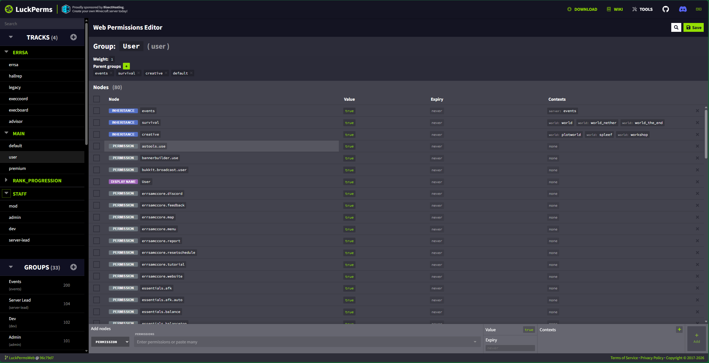

---
tags:
  - DEV
  - SERVER LEAD
---


---
tags:
- DEV
- SERVER LEAD
---

# Module 2 · Plugin Management

Plugins are the foundation of many of ERRSA MC's systems. They allow us to extend Minecraft beyond its vanilla 
capabilities, introduce custom features, manage player permissions, and connect different parts of our network.

A large portion of a Developer's responsibilities involves working with plugins. However, managing plugins is not 
simply a matter of downloading a `.jar` file and uploading it to the server. Every change can potentially affect 
gameplay, server performance, existing features, or other plugins.

This module introduces how plugins function, how to evaluate changes, and how to manage them safely within ERRSA's infrastructure.

It is not intended to teach custom plugin development or advanced troubleshooting. Those topics are covered in later modules.

!!! info "Before you begin"
        You should have completed [Module 1 · Server Architecture](mod1.md){ data-preview }, including an understanding of ERRSA's Velocity 
        proxy, Paper backend servers, and Apex Hosting infrastructure.

By the end of this module, you should be able to:

- Understand how plugins are installed, configured, and managed.
- Evaluate whether a proposed plugin change is necessary.
- Identify plugin compatibility requirements and dependencies.
- Recognize potential plugin conflicts.
- Understand basic plugin configuration and permission nodes.
- Safely plan plugin installations, updates, replacements, and removals.
- Recognize when a change requires Server Lead approval.
- Explain the importance of backups, testing, and rollback procedures.

---

## Understanding Plugins

Plugins are software extensions that add functionality to a Minecraft server.

Most plugins used by ERRSA are written in Java and distributed as compiled `.jar` files. These files contain the 
code executed by the server or proxy.

Plugins may introduce entirely new features or modify existing Minecraft behavior.

For example:

| Plugin | Purpose |
| --- | --- |
| EssentialsX | Provides common server commands and utilities. |
| GriefPrevention | Protects player claims and helps prevent griefing. |
| LuckPerms | Manages groups and permission assignments. |
| Multiverse-Core | Allows multiple worlds to exist on a Paper server. |
| Geyser | Translates Bedrock protocol traffic for Java-based servers. |
| ERRSA-MC-Core | Provides custom functionality developed for ERRSA. |

Some plugins operate independently, while others depend on additional plugins, shared services, 
databases, or network communication.

Understanding these relationships is essential before making changes.

### Plugin Files and Data

A plugin will commonly involve several types of files.

| File or folder | Purpose |
| --- | --- |
| `plugins/PluginName.jar` | Contains the compiled plugin code. |
| `plugins/PluginName/config.yml` | Contains configurable settings, if provided. |
| `plugins/PluginName/` | May contain additional configuration, data, or generated files. |
| External database | May store information outside the server's file system. |

Example:

```text
plugins/
├── EssentialsX.jar
├── GriefPrevention.jar
├── LuckPerms-Bukkit.jar
│
├── Essentials/
│   ├── config.yml
│   └── userdata/
│
├── GriefPreventionData/
│   ├── config.yml
│   └── PlayerData/
│
└── LuckPerms/
    └── config.yml
```

This is an illustrative structure. Actual folder names and contents vary between plugins.

!!! warning "Plugin data is not always stored locally"
        Some ERRSA plugins communicate with external databases or services. Removing a plugin's `.jar` does not
        necessarily remove its stored information.

    Likewise, deleting a plugin's data folder may permanently remove information that cannot be easily recreated.

    Never delete plugin data without understanding its purpose and receiving the required approval.

---

## Evaluating Plugin Changes

One of the most important responsibilities of an ERRSA Developer is understanding **when a plugin should be added, 
modified, replaced, or removed**.

Not every suggestion requires a new plugin, and not every technical problem should be solved by modifying the server.

ERRSA aims to maintain a stable Minecraft experience while providing features that strengthen our community.

Every change should have an identifiable purpose.

### Is the Change Necessary?

Before proposing a change, ask yourself:

- What problem are we trying to solve?
- Is this an actual problem or simply a preference?
- How many players are affected?
- Does the change align with ERRSA's goals?
- Will it introduce unnecessary complexity?
- Could it interfere with existing systems?
- Is the expected benefit worth the potential risks?

For example, a player may suggest adding a plugin that introduces a completely new transportation system.

Although the feature may be convenient, it could reduce the usefulness of existing transportation methods or conflict 
with intentional gameplay decisions.

The purpose of this evaluation is not to reject new ideas. It is to ensure that proposed changes are considered carefully.

### Implementation Options

Once the problem is understood, investigate the possible solutions.

Common options include:

1. Adjusting an existing plugin's configuration.
2. Using an existing feature that players may not know about.
3. Updating an existing plugin to resolve a known issue.
4. Installing an existing third-party plugin.
5. Modifying an ERRSA-owned plugin.
6. Developing a new custom plugin.
7. Making no change if the benefits do not justify the risks.

!!! tip "Start with the existing system"
        Before installing or developing another plugin, determine whether the desired functionality can already be 
        achieved through something installed on ERRSA.

    The simplest reliable solution is generally preferable to introducing additional software.

### Existing Plugins vs. Custom Development

When a new feature is necessary, ERRSA generally prefers evaluating existing plugins before developing one from scratch.

Existing plugins may offer several advantages:

- Features may already have undergone testing.
- Bugs and compatibility issues may already be documented.
- Development time is reduced.
- Updates and maintenance may be handled by the original developer.
- Existing documentation and community support may be available.

However, an existing plugin is not automatically the best solution.

It may introduce unnecessary features, create compatibility problems, conflict with our infrastructure, or become unsupported.

Custom development may be preferable when:

- No suitable existing solution is available.
- The feature requires ERRSA-specific behavior.
- Existing plugins introduce unacceptable limitations.
- The functionality must integrate closely with our existing systems.
- Maintaining a small custom implementation would be more practical.

Custom development also creates long-term responsibilities. ERRSA must maintain the code, address bugs, and evaluate 
compatibility during future server updates.

These responsibilities are introduced further in [Module 3](mod3.md){ data-preview }.

### Researching Plugins

When evaluating third-party plugins, developers should investigate more than the plugin's description.

Important considerations include:

| Consideration | What to investigate |
| --- | --- |
| Source | Is the plugin distributed by a trustworthy developer or organization? |
| Compatibility | Does it support our server software and Minecraft version? |
| Dependencies | Does it require other plugins or services? |
| Maintenance | Is the plugin actively maintained or reasonably stable? |
| Documentation | Are installation and configuration instructions available? |
| Known issues | Are there unresolved bugs relevant to ERRSA? |
| Performance | Could the plugin introduce significant resource usage? |
| Data storage | Does it create files or require a database? |
| Security | Does it introduce unnecessary access or external connections? |

Common sources for plugin information include:

- [Modrinth](https://modrinth.com/plugins)
- [Hangar](https://hangar.papermc.io/)
- [SpigotMC Resources](https://www.spigotmc.org/resources/)
- [PaperMC Documentation](https://docs.papermc.io/)
- Official plugin documentation and source repositories.

!!! warning "Third-party software"
        Plugin `.jar` files contain executable code.

    Do not download plugins from random file-sharing websites or unverified sources. A malicious or compromised plugin 
    may affect the entire server, including its files and connected services.

    Plugins obtained from reputable sources should still be reviewed for compatibility and potential risks.

### Server Lead Approval

Developers do not independently determine the direction of the server.

The Server Leads are responsible for approving changes that affect ERRSA's infrastructure, gameplay, and player experience.

Before implementing a proposed change, communicate:

1. **The problem:** What is happening, and why does it matter?
2. **The proposed solution:** What specifically would change?
3. **Alternatives:** Are other solutions available?
4. **Risks:** What could break or behave differently?
5. **Implementation:** How would the change be tested and deployed?

Approval should be obtained before making changes that require authorization.

Routine investigations and other actions within a Developer's assigned permissions may not require separate approval 
each time. However, developers should never assume that access to a system automatically grants permission to modify it.

!!! danger "Production changes"
        Do not add, remove, replace, or substantially modify plugins on production servers without the appropriate authorization.

    When uncertain about whether a change requires approval, communicate with the Server Leads before proceeding.

---

## Plugin Compatibility

Selecting the correct plugin requires understanding three separate compatibility considerations:

1. Server software.
2. Minecraft version.
3. Java runtime version.

A plugin may satisfy one requirement while failing another.

### Server Software Compatibility

As explained in Module 1, ERRSA operates both Paper backend servers and a Velocity proxy.

These platforms serve different purposes and use different plugin APIs.

**Paper backend servers**

Paper plugins are designed to operate on the Minecraft backend.

Paper also provides compatibility with many Bukkit and Spigot plugins, although compatibility is not guaranteed for every plugin.

| Plugin platform | Paper compatibility |
| --- | --- |
| Paper | Intended platform |
| Bukkit / Spigot | Often compatible; verify individually |
| Velocity | Not directly compatible |
| Fabric / Forge / NeoForge / Quilt | Not standard Paper plugins |

**Velocity proxy**

Velocity requires plugins specifically developed to operate with its proxy API.

| Plugin platform | Velocity compatibility |
| --- | --- |
| Velocity | Intended platform |
| Paper / Bukkit / Spigot | Not directly compatible |
| Fabric / Forge / NeoForge / Quilt | Not standard Velocity plugins |

!!! warning "Know where a plugin belongs"
        A plugin designed to manage player connections at the proxy cannot necessarily be installed on a Paper backend.

    Similarly, a plugin that modifies world blocks or inventories will normally need to operate on the relevant backend rather than the proxy.

Before downloading anything, identify which part of ERRSA's infrastructure requires the functionality.

### Minecraft Version Compatibility

Minecraft updates may modify internal systems, APIs, or behavior used by plugins.

As a result, plugins may require updates to remain compatible.

However, plugins are not automatically incompatible simply because their advertised Minecraft version differs from the server version.

Some plugins support multiple Minecraft versions, while others rely on version-specific functionality.

For example, ERRSA has used Paper 1.21.4.

A plugin advertised for Minecraft 1.21.4 is a reasonable candidate, but its compatibility should still be verified.

A plugin advertised for another version requires further investigation rather than automatically being considered functional or broken.

When evaluating compatibility:

1. Check the plugin's supported Minecraft versions.
2. Read its release notes and documentation.
3. Confirm whether the installed server version is supported.
4. Review known incompatibilities.
5. Test functionality before production deployment.

### Java Runtime Compatibility

Minecraft Java Edition servers and many plugins require a Java runtime.

Java runtime versions are separate from Minecraft versions.

For example, Paper 1.21.4 commonly runs on Java 21.

A plugin compiled for a newer Java runtime may fail to load on an older runtime.

For instance:

| Plugin requirement | Server runtime | Expected result |
| --- | --- | --- |
| Java 21 | Java 21 | Runtime requirement satisfied |
| Java 17 | Java 21 | Generally compatible at the runtime level |
| Java 25 | Java 21 | Cannot normally load classes requiring Java 25 |

Meeting the Java requirement does not guarantee that the plugin is compatible with the Minecraft version or server platform.

!!! info "Minecraft and Java versions are separate"
        Updating Minecraft does not automatically mean the Java programming language has changed.

    Always verify the Java runtime requirements of the server software and plugin independently.

### Multi-Version Support

ERRSA uses ViaVersion and related compatibility systems to support players connecting from different Minecraft versions.

These tools help clients communicate with the server, but they do not automatically make outdated plugins compatible with newer server software.

For example:

> A player running a newer Minecraft client may successfully connect through ViaVersion.
>
> However, a plugin installed on Paper must still be compatible with the server software and its underlying Minecraft version.

For more information about where these tools operate, review [Module 1](mod1.md){ data-preview }.

---

## Plugin Conflicts

Even when plugins meet their compatibility requirements, they may interfere with one another.

A plugin conflict occurs when two or more plugins interact in a way that causes unexpected or undesirable behavior.

Conflicts are not always obvious.

A server may start successfully while certain commands, events, or gameplay features fail to behave correctly.

### Common Types of Conflicts

| Conflict | Example |
| --- | --- |
| Command conflicts | Two plugins register the same command. |
| Event conflicts | Multiple plugins modify or cancel the same player interaction. |
| Gameplay conflicts | Two plugins attempt to control the same mechanic. |
| Permission conflicts | Different systems affect who can perform an action. |
| Data conflicts | Plugins interact incorrectly with shared information. |
| Performance issues | Heavy workloads create delays that affect other systems. |

### Example: PvP and Container Interactions

Suppose ERRSA wants to allow players to open containers during PvP combat.

However, GriefPrevention provides combat restrictions designed to discourage players from escaping or protecting items during combat.

A developer should investigate:

- Which plugin is blocking the interaction?
- Does the plugin offer a setting to change this behavior?
- Is the behavior intentionally part of the combat system?
- Could changing it introduce new exploits?
- Would another plugin conflict with the existing protection system?

Installing another plugin that attempts to override the restriction may introduce additional problems rather than resolve the original issue.

The correct approach is to understand the interaction before selecting a solution.

### Investigating Conflicts

A basic investigation may involve:

1. Identifying the affected feature.
2. Determining which plugins interact with that feature.
3. Reviewing their configuration and documentation.
4. Checking available error messages and logs.
5. Reproducing the issue in a controlled testing environment.
6. Testing one proposed change at a time.
7. Recording the results.

!!! tip "Do not assume the most recent plugin is responsible"
        An issue appearing after an update may involve multiple plugins, configuration changes, or previously unnoticed behavior.

    Investigate the evidence before assigning a cause.

Advanced troubleshooting methods are covered in a later module.

---

## Plugin Dependencies

Plugins can rely on other plugins, libraries, or services to provide functionality.

These relationships are called dependencies.

Before installing, updating, replacing, or removing a plugin, developers must understand what depends on it.

### Hard Dependencies

A hard dependency is another plugin that must be available for the dependent plugin to load correctly.

If a required dependency is missing or incompatible, the dependent plugin may fail to enable.

For example:

> Plugin A requires Plugin B to provide a necessary service.
>
> If Plugin B is removed, Plugin A cannot operate correctly.

Hard dependencies are commonly declared in plugin metadata.

### Soft Dependencies

A soft dependency is an optional plugin integration.

The dependent plugin may still function without it, but certain features or integrations may become unavailable.

For example:

> Plugin A can operate independently.
>
> When Plugin B is installed, Plugin A enables an additional integration.

Not every optional integration is formally declared as a soft dependency.

Always consult the plugin documentation and metadata to understand its actual requirements.

### Example: QuickShop and the Economy

ERRSA's economy involves several interconnected systems.

A shop plugin such as QuickShop-Hikari may use Vault to communicate with the server's economy provider.

Vault acts as an intermediary between plugins and supported economy systems.

Conceptually:

```text
QuickShop
    |
    v
  Vault
    |
    v
Economy Provider
```

If an essential component of this integration is unavailable, shop transactions may stop functioning correctly.

QuickShop-Hikari lists Protocolib as a soft dependency. Removing Protocolib, will still allow shops to function but at the
cost of losing display items.

However, the exact hard and soft dependencies depend on the installed plugin version and configuration.

Do not assume that every plugin in an integration is a declared hard dependency.

### Cross-Server Dependencies

Some ERRSA systems operate across multiple server instances.

For example, a network feature might involve:

- A Velocity plugin.
- A corresponding Paper plugin.
- A shared database.
- Communication between these components.

A plugin may appear to load successfully while its connection to another component is unavailable.

This means a plugin's dependency requirements may extend beyond other `.jar` files.

!!! warning "Dependencies affect removal"
                Removing a plugin without checking its dependencies can break unrelated features.

    Before removing or replacing a plugin, identify the systems that depend on it and determine how they will be affected.

---

## Plugin Configuration

Many plugins provide configuration files that allow developers to change behavior without modifying Java code.

Common configuration file formats include:

- YAML (`.yml` or `.yaml`)
- JSON (`.json`)
- TOML (`.toml`)
- Properties (`.properties`)

The available format depends on the plugin.

### Understanding YAML

YAML is commonly used for Minecraft plugin configuration.

Consider the following example:

```yaml
features:
  enabled: true
  cooldown-seconds: 30

messages:
  welcome: "Welcome to ERRSA!"

blocked-worlds:
  - Lobby
  - PlotWorld
```

This configuration includes several common elements.

| Element | Explanation |
| --- | --- |
| `features:` | A section containing related settings. |
| `enabled: true` | A Boolean value enabling a feature. |
| `cooldown-seconds: 30` | A numeric setting. |
| `welcome:` | A text setting. |
| `blocked-worlds:` | A list of values. |

YAML relies on indentation to organize information.

Incorrect indentation or formatting may cause a plugin to reject its configuration or interpret it incorrectly.

For example:

```yaml
features:
  enabled: true
  cooldown-seconds: 30
```

is not structured the same as:

```yaml
features:
enabled: true
cooldown-seconds: 30
```

The second example does not correctly nest the values under `features`.

### Editing Configurations

Before modifying a configuration:

1. Confirm which plugin and server instance the file belongs to.
2. Review the plugin documentation.
3. Understand what the setting controls.
4. Determine whether other systems depend on the behavior.
5. Obtain approval when required.
6. Back up the original configuration.
7. Make the change in an appropriate environment.
8. Validate the configuration and test the result.

Some plugins support configuration reload commands, while others require a restart.

Do not assume that a reload command safely applies every setting.

When the plugin's documentation requires a restart, follow that requirement.

### Configuration Limitations

Not every plugin feature can be modified through configuration.

Some behavior is implemented directly in the plugin's code.

For example, a plugin may allow developers to adjust the duration of a combat timer without allowing them to 
change every restriction associated with that timer.

If the required setting does not exist, possible solutions include:

- Using an alternative supported feature.
- Requesting a change from the plugin developer.
- Evaluating a maintained alternative or fork.
- Modifying an ERRSA-owned plugin where appropriate.
- Developing another solution with approval.

Adding an undocumented setting to a configuration file does not guarantee the plugin will recognize it.

### Configuration Changes During Updates

Plugin updates may introduce, rename, or remove configuration settings.

Not every plugin automatically inserts newly introduced options into an existing configuration file.

Developers should compare release notes, default configurations, and migration instructions when updating.

!!! warning "Do not blindly replace existing configurations"
        Replacing an existing configuration with a newly generated default file can erase ERRSA-specific settings.

    Preserve the original, review differences, and migrate settings carefully.

### Plugin Data vs. Configuration

Configuration files control behavior.

Data files store information created or maintained while the plugin operates.

Examples may include:

- Player information.
- Claim information.
- Saved locations.
- Economy records.
- Plugin-generated databases.

Although both may exist inside a plugin's folder, they serve different purposes.

Developers must distinguish settings from persistent data before editing or deleting files.

---

## Plugin Permissions

Many plugins restrict functionality through permission nodes.

Permission nodes are identifiers used to determine whether a player or group can perform an action.

For example, a plugin may define permission nodes for:

- Accessing a command.
- Using an administrative feature.
- Bypassing a cooldown.
- Managing another player's information.
- Modifying protected areas.

ERRSA uses [LuckPerms](../../plugins/permissions-and-moderation/luckperms.md){ data-preview } to manage permissions and groups.



### Understanding Permission Nodes

An example plugin might define:

```text
example.use
example.admin
example.bypass
```

These permission nodes could control normal usage, administration, and bypass privileges.

The actual permission nodes available depend on the installed plugin.

### Permission Considerations

When adding or updating plugins, developers should investigate:

1. Which permission nodes the plugin introduces.
2. Which roles should receive access.
3. Whether any permissions allow administrative actions.
4. Whether the plugin includes bypass permissions.
5. Whether permission defaults could unintentionally grant access.

!!! danger "Permission bypasses"
                Some permissions can bypass protections or grant powerful administrative capabilities.

    Do not assign new permissions simply because a plugin requires configuration. Determine who should receive access 
and obtain approval when required.

This module introduces permission nodes. LuckPerms groups, inheritance, weights, tracks, and advanced permission 
management are covered separately.

---

## Plugin Lifecycle Management

Plugin management includes more than installation.

A Developer may be responsible for investigating, updating, replacing, configuring, or removing plugins during their time with ERRSA.

Each operation introduces different risks.

### Installing Plugins

Before installing a plugin:

1. Confirm the feature is necessary and approved.
2. Research available solutions.
3. Verify the intended server platform.
4. Verify Minecraft and Java runtime compatibility.
5. Identify dependencies and possible conflicts.
6. Obtain the plugin from a trusted source.
7. Identify any existing data or functionality that could be affected.
8. Prepare a testing and rollback plan.

Once the necessary checks are complete, the installation can be tested.

A typical installation on a Paper backend involves:

1. Stopping the appropriate testing server.
2. Uploading the compatible `.jar` to its `plugins/` directory.
3. Installing any required dependencies.
4. Starting the server.
5. Checking the startup logs.
6. Reviewing generated configuration files.
7. Configuring and restarting as required.
8. Testing the intended functionality.

Velocity plugins follow a similar general process but must use compatible Velocity builds and their own documentation.

!!! info "One server does not represent the whole network"
        Installing a plugin on the Primary backend does not automatically install it on Events, Testing, or Velocity.

    Confirm exactly where each component needs to operate.

### Updating Plugins

Plugin updates may introduce:

- Bug fixes.
- Security improvements.
- New features.
- Compatibility updates.
- Configuration changes.
- Changes to stored data.
- Removed or modified functionality.

An update is not automatically risk-free simply because it is newer.

Before updating:

1. Review the changelog.
2. Identify any breaking changes.
3. Check server and dependency compatibility.
4. Determine whether configuration or data migration is required.
5. Prepare backups.
6. Test the new version.
7. Obtain the necessary approval for deployment.

For a typical approved `.jar` replacement:

1. Stop the affected server.
2. Confirm the necessary backups are available.
3. Remove or archive the previous plugin `.jar`.
4. Upload the replacement `.jar`.
5. Preserve existing data and configurations unless migration instructions require changes.
6. Start the server and review its logs.
7. Complete any required configuration migration.
8. Restart again if necessary.
9. Verify the plugin and its integrations.

Do not leave multiple incompatible versions of the same plugin in the plugins directory.

### Removing or Replacing Plugins

Removing a plugin may affect more than its own functionality.

Before removing one, determine:

- Whether other plugins depend on it.
- Whether it provides an essential server service.
- Whether players rely on its stored information.
- Whether its configuration or data should be preserved.
- Whether removing it changes permissions or protections.
- Whether an alternative plugin will replace it.

A plugin's `.jar` can generally be removed while the server is stopped, but its stored data should not automatically be deleted.

If replacing a plugin, review whether the replacement supports migration from the previous system.

!!! warning "Replacing plugins does not guarantee data compatibility"
        Two plugins providing similar features may use entirely different data formats.

    For example, replacing a claim-protection plugin does not automatically transfer existing claims.

    Data migration must be investigated separately.

---

## Backups and Rollback

Backups allow developers to recover from unexpected problems.

A rollback plan defines how a change can be reversed if testing or deployment fails.

Both should be considered before making significant modifications.

### What Should Be Backed Up?

The required backup depends on the affected system.

| Change | Potential backup requirements |
| --- | --- |
| Configuration edit | Original configuration file |
| Plugin update | Previous `.jar`, configuration, and plugin data |
| Plugin replacement | Existing plugin files, data, and related integrations |
| Database change | Relevant database backup or export |
| Major infrastructure change | All affected files, worlds, configurations, and external data |

ERRSA uses Apex Hosting to manage its server infrastructure.

The availability and coverage of panel backups should be verified before relying on them.

A backup of a server's files may not include external databases or services.

For significant changes, additional backups may be required.

### Using FTP Safely

FTP-based file management tools can be useful for transferring large numbers of files or creating local backups.

However, file management mistakes can damage a server's directory structure.

Developers should:

- Confirm the correct server and directory.
- Avoid unintentionally moving or renaming folders.
- Verify upload and download destinations.
- Preserve the existing file structure.
- Prefer secure transfer methods supported by the hosting environment.
- Check that downloaded backups are complete.

!!! warning "Verify file operations"
        Be especially careful when using drag-and-drop in file managers or FTP clients.

    Accidentally moving an entire folder into another directory may prevent a server or plugin from functioning correctly.

    Use an input method that provides reliable control and verify the result before restarting.

### Rollback Planning

Before deploying a change, ask:

> If this fails, can we safely return the server to its previous state?

For a simple plugin update, rollback may involve restoring the earlier `.jar` and its configuration.

However, some plugin updates modify stored data or database schemas.

In those situations, simply restoring the old `.jar` may not be sufficient.

A rollback plan must account for any data migration or irreversible changes.

!!! danger "Backups must be usable"
        A backup is only useful if it contains the information needed for recovery.

    Verify backup coverage, integrity, and access before relying on it.

---

## Using the Testing Server

ERRSA maintains a separate Testing backend to investigate changes before introducing them to the Primary server.

As explained in Module 1, the Testing server is intended to provide a controlled environment for evaluating changes.

Testing is especially important because ERRSA operates multiple interconnected systems.

### What Should Be Tested?

Depending on the change, developers should verify:

- The server starts successfully.
- The plugin loads without relevant errors.
- Required commands and features operate correctly.
- Configuration settings behave as intended.
- Permissions are applied correctly.
- Existing systems continue to function.
- Dependencies and integrations remain available.
- No unexpected data changes occur.

### Maintaining an Accurate Test Environment

Testing is most useful when the test environment reasonably represents the affected production system.

Important considerations include:

- Server software version.
- Installed plugin versions.
- Configuration differences.
- World or test data.
- External integrations.
- Permission behavior.

However, the Testing server must remain appropriately isolated from production.

!!! danger "Testing isolation"
        A test environment should not unintentionally modify live player data, production databases, or external services.

    Before testing plugins that communicate with SQL, Velocity, Discord, or other integrations, verify which systems they are connected to.

    Never assume that copying a production configuration automatically makes it safe for testing.

### Documenting Test Results

A developer should be able to explain:

1. What was changed.
2. Why the change was necessary.
3. What functionality was tested.
4. Whether the test succeeded.
5. Whether unexpected behavior occurred.
6. Whether the change is ready for review or deployment.

For example:

> **Change:** Updated a plugin to resolve an interaction issue.
>
> **Environment:** Testing server.
>
> **Results:** Plugin loaded successfully, intended functionality worked, and related features showed no issues during the tests performed.
>
> **Remaining concerns:** Additional testing of specific edge cases may be necessary.
>
> **Status:** Ready for Server Lead review.

Testing does not guarantee that every possible issue has been discovered, but it significantly reduces the risks associated with changes.

---

## Example: Evaluating a Plugin Request

Consider the following scenario:

> Players suggest adding gravestones so that their items remain recoverable after death.

A Developer should not immediately download and install the first gravestone plugin they find.

Instead, follow the evaluation process.

### Step 1: Understand the Request

Determine what players are trying to achieve.

Are they primarily concerned about finding their death location, recovering items before despawn, or preventing permanent item loss?

These problems may have different solutions.

### Step 2: Evaluate Gameplay Impact

Consider whether the feature would change existing survival mechanics.

For example, indefinite item protection could significantly reduce the consequences of dying.

Possible alternatives might include:

- Providing death coordinates.
- Extending the recovery opportunity.
- Introducing temporary gravestones.
- Limiting the number of unclaimed gravestones.

The appropriate solution depends on ERRSA's gameplay goals.

### Step 3: Investigate Implementation Options

Research whether existing plugins can provide the approved behavior.

Determine whether they support:

- Grave expiration.
- Limits on active graves.
- PvP-specific behavior.
- Configurable item recovery.
- Compatible server versions.

### Step 4: Identify Risks

Potential concerns include:

- Conflicts with existing item protection.
- Changes to PvP rewards.
- Persistent item storage.
- Unexpected item duplication or loss.
- Additional data storage.
- Plugin maintenance and compatibility.

### Step 5: Present the Recommendation

Explain the available options, expected benefits, and potential risks to the Server Leads.

Only proceed with the approved solution.

!!! tip "Think beyond whether something works"
        A Developer's responsibility is not limited to making software function.

    Developers should understand how technical decisions affect ERRSA's gameplay, infrastructure, maintainability, and community.

---

## Check Your Understanding

Consider the following scenarios before continuing.

### Scenario 1 — Compatibility

You find a plugin that provides a useful feature, but its download page only offers a Velocity build.

The feature is intended to modify blocks in the Primary server's Survival world.

**Questions:**

- Can the Velocity `.jar` simply be uploaded to Paper?
- What should you investigate before recommending the plugin?
- Where would the appropriate implementation normally need to operate?

### Scenario 2 — Dependencies

A Developer suggests removing Vault because players do not directly interact with it.

**Questions:**

- Why might removing Vault affect other plugins?
- What should be checked before removing it?
- Why is the absence of player-facing commands not evidence that a plugin is unnecessary?

### Scenario 3 — Configuration

An updated plugin includes new settings in its documentation, but those settings do not appear in ERRSA's existing configuration.

**Questions:**

- Should the existing configuration be deleted immediately?
- How would you determine whether the settings need to be added manually?
- What should be backed up before making changes?

### Scenario 4 — Plugin Conflicts

Players report that an interaction fails only while they are engaged in PvP.

Two installed plugins may be involved.

**Questions:**

- Why should you avoid immediately disabling one of the plugins?
- How could configuration settings contribute to the issue?
- How would you investigate the problem safely?

### Scenario 5 — Testing

A plugin works correctly on the Testing server but connects to a database also used by Primary.

**Questions:**

- Why could this be dangerous?
- What should be verified before continuing?
- Does successful plugin startup guarantee that the testing environment is safe?

### Scenario 6 — Approval

A Developer discovers a plugin that appears to solve a minor gameplay issue. The plugin is compatible and has positive reviews.

**Questions:**

- Does compatibility alone justify installing it?
- What are the next steps before implementation?
- Who should approve a change affecting production gameplay?

---

## Key Takeaways

Plugin management is a core responsibility of ERRSA Developers.

The most important principles from this module are:

1. **Understand the problem before selecting a solution.** Not every issue requires another plugin.
2. **Evaluate compatibility and dependencies.** A compatible `.jar` may still conflict with other systems.
3. **Protect existing functionality and data.** Configuration changes and plugin replacements can affect more than the intended feature.
4. **Research and test before deployment.** Production servers should not be used for unnecessary experimentation.
5. **Respect approval requirements.** Access to a system does not automatically authorize modifications.
6. **Plan for failure.** Maintain appropriate backups and understand how changes can be reversed.
7. **Document important changes.** Future developers should be able to understand what was modified and why.

The goal is not simply to add more functionality to ERRSA. It is to maintain a reliable, manageable, and enjoyable Minecraft experience.

---

## Resources

### ERRSA Documentation

- [Module 1 · Server Architecture](mod1.md){ data-preview }
- [Module 3 · Plugin Development](mod3.md){ data-preview }
- [LuckPerms](../../plugins/permissions-and-moderation/luckperms.md){ data-preview }
- [GriefPrevention](../../plugins/permissions-and-moderation/griefprevention.md){ data-preview }
- [Vault](../../plugins/server-and-infrastructure/vault.md){ data-preview }
- [ERRSA-MC-Core](../../plugins/server-and-infrastructure/errsa-mc-core.md){ data-preview }

### External Documentation

- [PaperMC Documentation](https://docs.papermc.io/)
- [Velocity Documentation](https://docs.papermc.io/velocity/)
- [Modrinth](https://modrinth.com/plugins)
- [Hangar](https://hangar.papermc.io/)
- [SpigotMC Resources](https://www.spigotmc.org/resources/)
- [YAML Introduction](https://yaml.org/)

---

<nav class="handbook-next" aria-label="Continue reading">
  <a href="../mod3/">
    <span class="handbook-next__copy"><small>Next section</small><strong>Module 3 · Plugin Development</strong><span>Learn about ERRSA-owned plugins and the development process.</span></span>
    <span class="handbook-next__arrow" aria-hidden="true">→</span>
  </a>
</nav>
