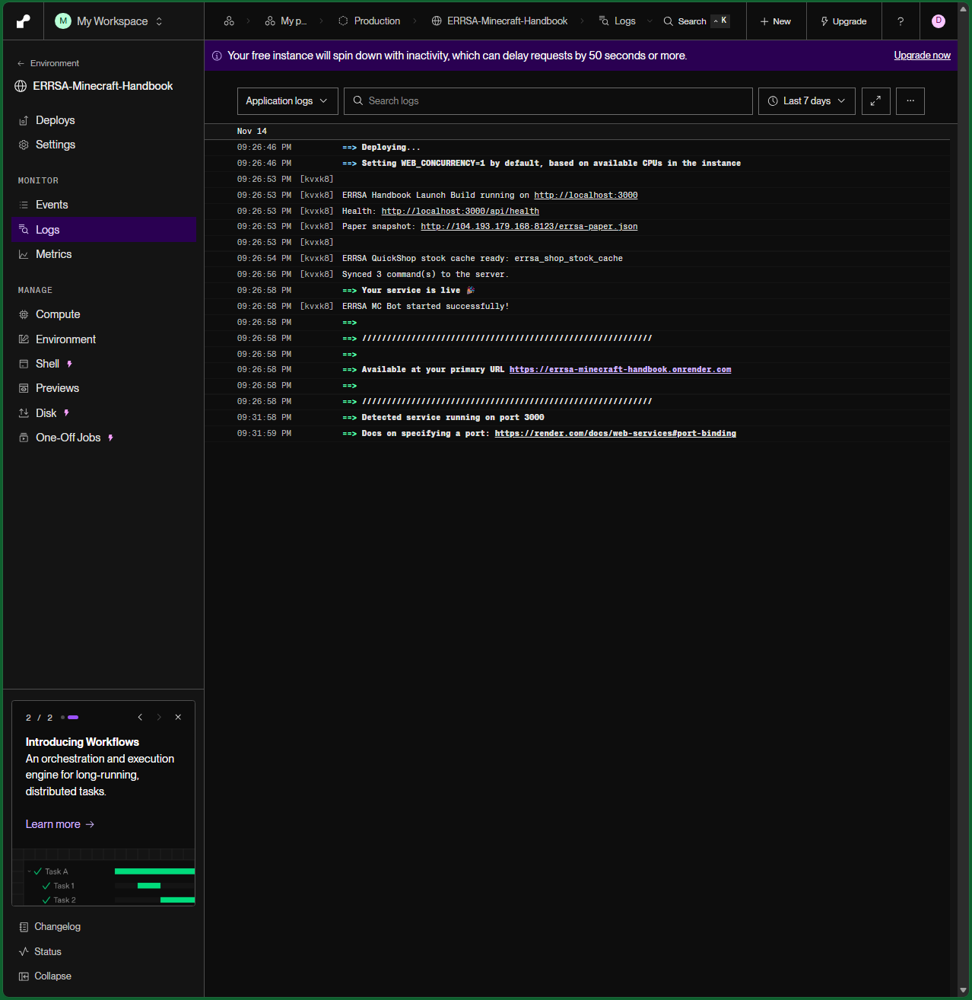
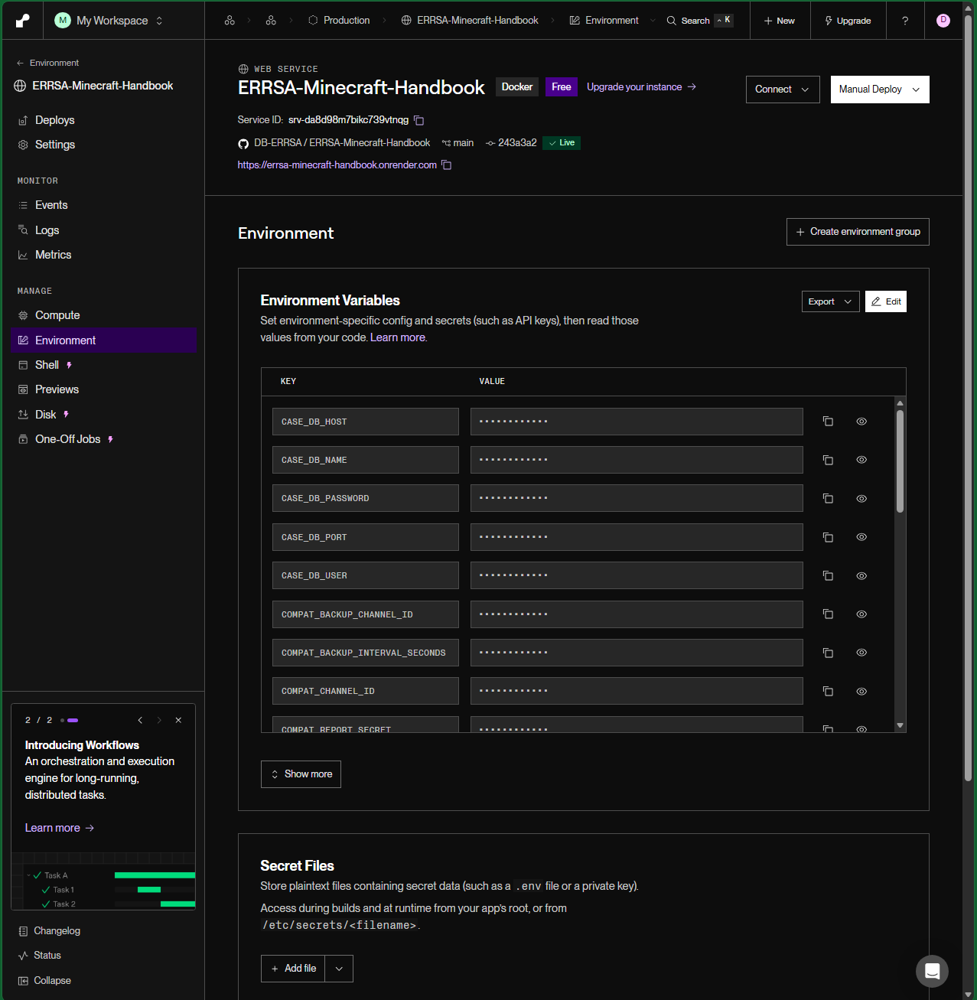

---
tags:
  - DEV
  - SERVER LEAD
---

# External Tools (addmonium about token,etc. safety)

Our Minecraft developers operate more than just the minecraft server file system which has been discussed in detail until
this point. They are also responsible for all the connections to the Minecraft network which live externally.

This module will explain each of the external tools we use, documentation, where the files live, and best practices. By
the end of this module you should have a good scope on the entirety of the Minecraft network at a high level.

!!!warning("This module discusses services with sensitive material")
        It is critical for our setups safety and the safety of players information that environment variables, tokens, and 
        other passwords are kept in safe/secure places approved by the server lead and should not be shared with anyone who
        does not require the information only to be used when actual work needs to be taken place. Assume all senesitive material
        left in places the public/staff can get access to without being secure will be taken granted of and will lead to 
        breaches in our servers security with destructive damage.

---

## [Discord](../../tools/discord)

Purpose: to automate and centralize communication, player reports, feedback, server reports and bugs, staff communication,
plugin logs from exploits, staff commands used, logging/documentation system, plugins responsible for player connection 
critical update alerts. Annnouncements, rules, centralized area for communication with palyewrs, submit tickets, voice chat.

We run several discord bots to help us maintain the discord: Carl-bot for automated moderation in discord channels, dyno bot
for logging changes and player activity, fillout form publishes submited forms to the discord so staff get instant notification
with an embed results message previous moderator module explains how to address and react to the messages in order to give status

ERRSA MC Bot for staff command in-game logging for admin actions like jail mute ban to keep everyone accountable and the
staff in the loop, staff logging to report players plugins and sending formal communication while keeping student emails private 
which uses Powerautomate, render, and SQL with living in discord
(moderator modules previosly expess how to use), sends compatibility reports for critical updates for ViaVersion,
Geyser, and Floodgate that may affect player connection so developers can restart the server to update them

Note: the discord is owned by the ERRSA Exec Board although we utilize more we must abide their rules and authority.

Discord allows for almost endless possiblities when it comes to connectins currenl;y we are connected to Minecraft, Fillout form,
SQL and power automate

Discord has a whole rank permissions system and was intentiolly created to limit power a person can have, if you need major changes 
you must coordinate with the server lead and recieve their approval.

Documentation:

Github bots

https://github.com/DB-ERRSA/ERRSA-Minecraft-Handbook (private repsoitroy will need server lead permission and authorization 
to contribute)

Where files live:

ERRSA MC Bot lives inside of the Server Handbook repository in Github, this is due to Render Services only allowing one free
service, so it runs the handbook in tandem with discord bot which works out since they parse from ERRSA-MC-Bot together. Due to 
sharing the same repository, both share the same README: 

STEPHEN FIX DISCORD TOOLS DOCUMENTATION MAKE README FOR WEBSITE

---

## [SQL](../../tools/phpmyadmin)

Purpose: SQL is a type of database (think of it as a more powerful excel, but catered towards data storage with the ability
to store millions of entries it's even over 2 decades older than excel). SQL is a super powerful program with their own
coding language solely for managing the database and filtering results. Per database can have limitless tables living within.

Apex Hosting provides a free external MySQL database hosted on phpmyadmin (specific type of SQL database) per each server. 
Even though we have multiple databases we normal keep a 2 database setup: ERRSA MC Network database 
(using the Primary Servers database) and testing server database. We keep the testing server intentionally separate 
so no accidents affect live data or overwrite the data since it is mirrored. Additionally, developers in training should 
not be given access to the rest of ERRSA MC Network until proven they can be trusted and relied to have the 
responsibility, for these reasons the testing server is kept as isolated as possible to give developers a way to work
without the possibility of causing issues to the network.

You may be wondering this is all great but if plugins can already keep database file inside their plugin folders, isn't it
better to keep them seperated in organized files within minecraft? Here are the benefits of having an external sql:

- Much harder to delete external databases then it is to in an internal database living in the FTP file system.
- Easy filter queering for debugging/investigations
- Much more power to change stuff with an easy web command box
- Easily download/upload
- Ability to have other external tools safely pull from the external database data (heavily used to communicate with powerautomate)
- Eats a lot less server resources rather than being hosted internally
- Ability to hook multiple servers to the same data (used for network permission systems by luckperms table between the network)

Documentation:

SQL coding

---

## Power Automate integrations

Power Automate is a very powerful Microsoft built tool for automating workflows. Power automate is strongest when it comes
to using Office360 products like Word, excel, outlook etcetera but can be used for a multitude of other connections. It operates
of other app connections and API. ERRSA pays for a premium subscription in order to have access to premium features like
HTTP connections which gives us access to connect to a multitude of external apps that don't have native connections.

Flows we currently have:

### Player Initialization

We won't speak too much about this as we have a full module dedicated to this. The reasoning behind using power automate
mainly comes down to ERAU IT infrastructure. To setup player initialization we had many solutions to be able to send emails
from Minecraft by using free mailing apps, but this might work for personal email but will always be blocked by the school 
network from being recieved by students. This narrowed down our options to using office360 products to send emails which 
brought us to 2 options: first one was using a local 24/7 running machine that would sync an Excel to the Playerinitilization database
anytime a new change was made the excel macro was able to send emails using an outlook macro from that excel. This  works very well,
but comes with the downsides of having to need a 24/7 device on a school email running constantly if power or network cuts out the 
loop shuts off, believe it or not we used this system for our first year of authenticating students. We knew that this was only
a temporary solution as power automate premium could do this with database connections and since its a office360 application
the IT infrastructure would accept emails sent from this service, there is much logic behind this setup which is documented and
thoroughly explained in later module.

---

## Render services

Render is an application that hosts and runs code on their machines which is needed for our Websites dynamic functionality
like displaying, operation status, player count, Guilds leaderboard & statistics, the current marketplace, quests 
and much more. Render also runs python code
for our ERRSA-MC-Bot logging system. For ERRSA-MC-Bot we mainly need render to keep senesitive passwords needed by the code 
secret like environment variables. We could always just remove errsa-mc-bot from render and have it's environment file hosted 
in github but with public repositories these sensitive passwords would become public. That is another use of render is it's ability
to store environment variables and secrets. The big downside with a free plan is that our resources are very limited, originally we
were hosting dynmap through redner until it ate all of our monthly allowance of resources and shut down our website until the following
month due to this we terminated dynmap from render and now leave the server to hosting the map which as you can see is why
we can't display the map on the server handbook rather players have to click a hyperlink. Render is automatically integrated with
discord and has it's own dashboard, console, and panels

If the ERRSA MC Server Handbook and/or the ERRSA-MC-Bot go offline render logs should be checked for any errors.

The metric to worry about is memory - Render only gives 512 MB of monthly memory usage any further usage will shutdown the
service until the following month where it resets. 

This is where our enviroment variables are safely kept locked from the public.

If there are any changes made or bugs related to the server handbook or the ERRSA-MC-Bot, Render must be checked for successful
deployment and monitored regularly after changes are made to forecast memory usage. This service requires coordination with
the server lead with their approval.

---

## Web and API integrations

Plugins on the server or other external tools may be integrated to websites or other services using API. For example, [ERRSA-MC-Core](../../plugins/server-and-infrastructure/errsa-mc-core.md)
is integrated into the staff wiki, server handbook, and pulls from Viaversion, Floodgate, and Geyser version control using 
a variety of APIs

---