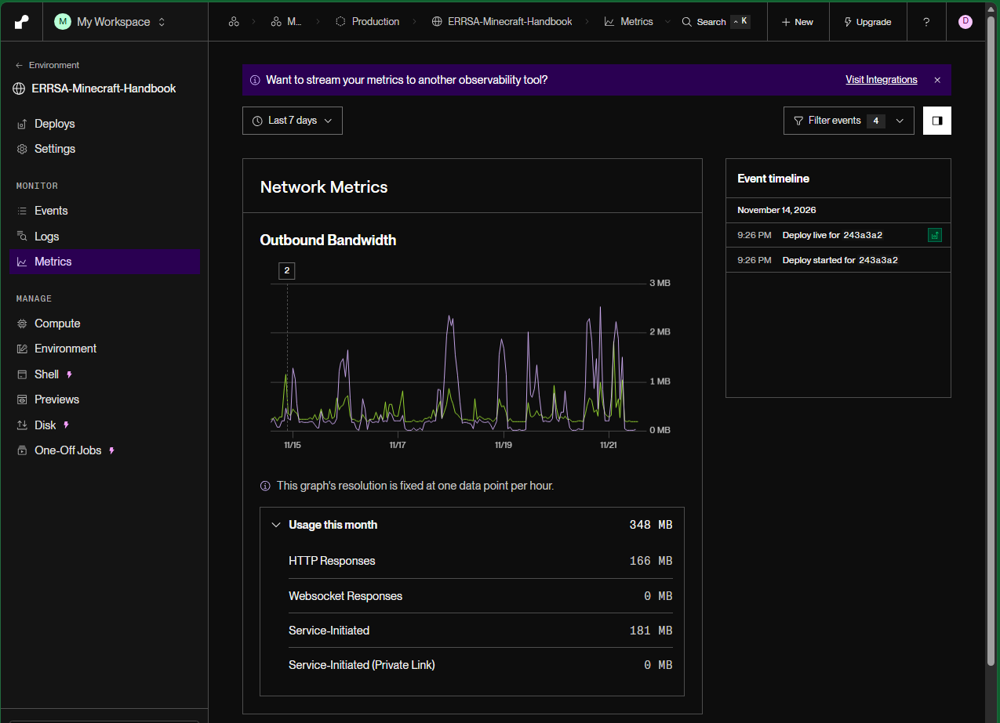

---
tags:
  - DEV
  - SERVER LEAD
---


# Module 4 · External Tools & Integrations

ERRSA Minecraft is more than the Paper servers and Velocity proxy introduced in [Module 1 · Server Architecture](mod1.md). 
Its plugins, community tools, websites, automation workflows, and databases also depend on services 
operating **outside the Minecraft server files**.

As a Developer, you may need to investigate these connections, maintain an approved integration, or help resolve a 
failure involving several systems. **Having technical access does not automatically grant permission to change a service.** 
Production access and modifications must follow the Server Leads' direction and ERRSA's broader organizational rules.

This module introduces the external services used by ERRSA, their roles, how they communicate, and the security 
expectations for handling them. Advanced troubleshooting is covered in [Module 5](mod5.md); PlayerInitialization's 
verification logic is covered in [Module 6](mod6.md).

!!! info "Prerequisites"
                Complete [Module 1 · Server Architecture](mod1.md), [Module 2 · Plugin Management](mod2.md), 
                and [Module 3 · Plugin Development](mod3.md). You should already understand Paper and Velocity, plugin 
                dependencies, configuration files, and why production changes require testing and authorization.

**Learning objectives**

By the end of this module, you should be able to:

- Identify ERRSA's external tools and the functions they support.
- Explain how Minecraft plugins exchange information with databases, bots, websites, and automation workflows.
- Distinguish SQL, MySQL, and phpMyAdmin.
- Recognize sensitive credentials and follow basic security and access-control practices.
- Interpret the basic purpose of Render deployments, logs, metrics, and environment variables.
- Understand how Power Automate supports verification and staff communications.
- Describe APIs, HTTP requests, JSON, authentication, and common integration failures.
- Know when to investigate, test, document, or escalate a change.

---

## External Service Security & Credentials

Before learning individual tools, understand how to protect the information that allows those tools to operate.

External services may have access to player records, staff communications, production databases, hosted 
applications, or Discord features. A single exposed credential could give an unauthorized person access to more 
than one system.

!!! danger "Tokens, passwords, and private information"
                **Never commit, paste, screenshot, or share real passwords, API keys, Discord bot tokens, database credentials, 
                session cookies, connection strings, webhook secrets, or other sensitive values** in GitHub repositories, wiki 
                pages, Discord channels, public issue trackers, or support requests.

    This applies even to **private repositories and staff-only channels**. Use an approved secret-management method 
    and give access only to people who need it for an authorized task.

    If a credential may have been exposed, **notify the Server Leads immediately**. The affected credentials
    should be treated as compromised and revoked or rotated as appropriate; simply deleting the visible message or 
    commit may not be sufficient.

### Common Credentials

| Credential | Purpose | Risk if exposed |
| --- | --- | --- |
| Discord bot token | Authenticates a bot application | Unauthorized operation of the bot under its granted permissions |
| Database username/password | Grants database access | Unauthorized reading or modification of stored data |
| API key or bearer token | Authenticates an application to an API | Unauthorized requests or access to protected resources |
| Webhook URL/secret | Allows a service to send or authenticate events | Forged notifications or unauthorized requests |
| Hosting/service credentials | Grants access to a service's administration | Unauthorized deployment, configuration, or data access |

### Environment Variables

A hosted application often needs a secret to start, such as a Discord bot token or database password. 
Environment variables can supply these values at runtime without embedding them directly in source code.

An illustrative application might expect:

```text
DISCORD_BOT_TOKEN=[REDACTED]
DATABASE_URL=[REDACTED]
```

These are **not real credentials**, just an example of the structure.

Environment variables reduce the need to store secrets in code, but they are **not automatically secure**. 
Anyone with sufficient access to the hosting environment, application process, or exposed diagnostic output may still 
be able to retrieve them. Limit dashboard access, avoid printing secrets in logs, and use the service's approved secret 
controls.

### Least Privilege and Approved Access

Developers should have only the access needed for their assigned work.

- Use separate testing credentials and production credentials whenever possible.
- Do not reuse production passwords for practice projects.
- Do not share accounts or credentials as a shortcut to granting access.
- Avoid making permission or role changes without the required approval.
- Keep sensitive player data out of examples, screenshots, and debugging messages.
- Before sharing logs or error reports, check whether they contain secrets or private information.
- Revoke access when it is no longer required.

!!! tip "Safe documentation examples"
                Use **fictional usernames, IDs, email addresses, tokens, and database records** in training materials. 
                If a real screenshot is necessary, redact sensitive values before publishing it.

### What To Do After a Possible Exposure

1. Stop sharing the affected material and inform the Server Leads promptly.
2. Identify which credential and services may be affected without reposting the secret.
3. Arrange for authorized revocation or rotation of the credential.
4. Update the approved secret store and dependent services.
5. Review access and logs for unexpected activity where appropriate.
6. Document the incident and any follow-up actions through approved staff channels.

Do not attempt to conceal a leak by deleting evidence or rewriting Git history without coordinating with the Server Leads.

---

## [Discord](../../tools/discord/index.md){ data-preview }

Discord is ERRSA's central community and staff communication platform. 
It connects player-facing information with Minecraft operations and staff workflows.

### How ERRSA Uses Discord

| Function | Examples |
| --- | --- |
| Community communication | Announcements, rules, events, voice chat, and general discussion |
| Player support | Reports, suggestions, feedback, tickets, and appeals |
| Staff coordination | Internal discussion, moderation activity, and follow-up |
| Automated submissions | Notifications and embeds from external forms such as Fillout |
| Operational alerts | Staff action logs, plugin notifications, and important compatibility reports |
| Connected workflows | Bot interactions with Minecraft, databases, and automation services |

Some submission and staff processes are explained in the [moderation training module 4](../moderators/mod4.md){ data-preview }
focuses on the **systems that deliver those messages**.

### Bots and Integrations

ERRSA uses multiple bots or services with different responsibilities.

| Bot or integration | ERRSA use                                                                                    |
| --- |----------------------------------------------------------------------------------------------|
| Carl-bot | Discord automation and moderation features                                                   |
| Dyno | Discord activity & moderation logging                                                        |
| Fillout integration | Routes submitted forms into staff-facing Discord notifications                               |
| ERRSA MC Bot | Supports Minecraft staff communications, action logging, and connected operational workflows |

The custom **ERRSA MC Bot** supports [staff command/activity records, staff communications](../moderators/mod6.md){ data-preview },  
and Minecraft-related alerts. In ERRSA's current architecture, it also interacts with other services such as Render,
MySQL, and Power Automate. The precise behavior of an individual command or automation should be checked in its 
maintained documentation and source. STEPHEN MAKE DOCUMENTATION

### Discord Access and Permissions

The Discord server belongs to the **ERRSA Executive Board**. Minecraft developers and staff operate within its 
established authority and rules.

Three Discord functions to know:

- **Discord roles:** Determine what a user can see or do in the server.
- **Bot application permissions:** Determine which Discord actions a bot is authorized to perform.
- **Bot tokens:** Credentials used to authenticate the application itself.

A developer's ability to edit bot code does not automatically authorize modifying Discord roles, inviting applications, 
or changing server-wide settings. Coordinate major changes with the Server Leads and any other required ERRSA leadership.

### Where the Code Lives

The **ERRSA Minecraft Server Handbook GitHub repository** is the location of the 
ERRSA MC Bot's source alongside handbook-related code, with the hosted application running through Render.

- [ERRSA Minecraft Handbook repository](https://github.com/DB-ERRSA/ERRSA-Minecraft-Handbook) — private repository access 
requires authorization to view.
- [ERRSA Discord tools documentation](../../tools/discord/index.md){ data-preview }
- [GitHub tools documentation](../../tools/github/index.md){ data-preview }

!!! info "Verify the current deployment"
                Repository organization and hosting arrangements can change. Before modifying a bot, confirm its 
                current repository, active Render service, deployment configuration, and authorization. Never infer 
                production deployment details solely from a local checkout.

---

## [MySQL and phpMyAdmin](../../tools/phpmyadmin/index.md){ data-preview }

ERRSA uses relational databases to store persistent information and allow authorized systems to share data. 
You will encounter three related terms:

| Term | Meaning |
| --- | --- |
| **SQL** | The language used to query and manage relational data |
| **MySQL** | A database management system that stores and serves relational data |
| **phpMyAdmin** | A browser-based administration interface for MySQL/MariaDB databases |
| **Database** | An organized collection of data |
| **Table** | A structure containing rows and columns within a database |

SQL is **not itself a database**, and phpMyAdmin is **not the database server**. phpMyAdmin is one way to inspect 
or administer information stored in MySQL.

### Why ERRSA Uses External Databases

Some plugins store data in local files or embedded databases such as SQLite. Others can connect to a separate MySQL server.

For ERRSA, a shared external database can provide:

- A central source of information for more than one server or service.
- Access from approved plugins, websites, bots, or automation processes.
- Structured querying and filtering for investigations or maintenance.
- Separation of persistent data from the files of one particular Minecraft instance.
- Support for network-wide systems, such as shared permission data through LuckPerms.

External storage introduces its own network connections, credentials, backup requirements, and its own availability 
risks. The appropriate storage method depends on the plugin and intended use.

### Production and Testing Database Separation

The draft describes two principal database environments:

1. **ERRSA MC Network / production data**, associated with the Primary server database infrastructure and shared by 
   relevant live network systems.
2. **Testing data**, kept separate so developers can reproduce issues and work on changes without unintentionally 
   affecting live records.

This separation is intentional. Developers in training should work within the permissions and isolated resources 
assigned to them rather than receiving broad production access by default.

!!! danger "Testing isolation"
                Before starting a copied or mirrored plugin on the Testing server, **verify its database host, 
                database name, credentials, and any connected external services**. Copying a production configuration 
                can accidentally reconnect a test instance to live data.

    The existence of a separate test database does not guarantee that every plugin is using it.

### Reading and Modifying Data

For example, a example table could be queried with:

```sql
SELECT username, status
FROM example_players
LIMIT 10;
```

This is a **read-only example** against an imaginary table. It illustrates how `SELECT` retrieves records; the table 
name is not an ERRSA production table.

| SQL operation | General purpose | Caution |
| --- | --- | --- |
| `SELECT` | Reads information | Protect sensitive data and avoid unnecessarily expensive queries |
| `INSERT` | Adds records | May create incorrect or duplicate information |
| `UPDATE` | Modifies records | Can change many rows if used incorrectly |
| `DELETE` | Removes records | Can permanently remove information |
| `DROP` | Removes database objects | Destructive; never use casually |

Do not experiment with data-changing commands on production databases. Review the affected tables, obtain approval, 
make appropriate backups, and understand how connected applications may cache or overwrite the data.

!!! warning "Manual edits to live plugin data"
                Existing ERRSA phpMyAdmin guidance warns that manual database changes can affect running plugins and 
                instructs staff to stop the **affected Minecraft server** before editing plugin data. Follow that 
                operational guidance and coordinate any additional connected services that may continue writing to the 
                same records.

    Not every database investigation requires a shutdown: distinguish read-only inspection from approved manual mutation, 
    and verify the relevant system's requirements.

### Further Reading

- [ERRSA phpMyAdmin documentation](../../tools/phpmyadmin/index.md){ data-preview }
- [MySQL documentation](https://dev.mysql.com/doc/)
- [phpMyAdmin documentation](https://docs.phpmyadmin.net/)

---

## [Power Automate](../../tools/power-automate/index.md){ data-preview }

Power Automate is Microsoft's workflow automation platform. It can connect Microsoft 365 applications with other 
supported services and APIs, allowing a workflow to respond to triggers and perform actions.

### Core Concepts

| Term | Meaning |
| --- | --- |
| **Flow** | A workflow containing one or more steps |
| **Trigger** | An event or request that starts the flow |
| **Action** | A step performed by the flow |
| **Connection** | An authorized link to an external service/account |
| **Run history** | A record used to inspect workflow executions and failures |

### How ERRSA Uses It

The existing ERRSA tools documentation identifies two primary areas:

- **PlayerInitialization:** Supports the process used to initialize and verify players.
- **Discord communication logs:** Supports connected staff communication and logging workflows.

Power Automate can coordinate events across Minecraft-related systems, databases, email, and Discord. 
It is one part of a larger workflow, rather than a replacement for the Minecraft plugin itself.

### PlayerInitialization: High-Level Flow

At a conceptual level:

```text
PlayerInitialization / Minecraft
             |
             v
      MySQL data and status
             |
             v
       Power Automate
             |
             v
      Email / workflow action
             |
             v
   Status reflected in the system
```

This is an **illustration of the participating systems**, the detailed verification states, approvals, denials, 
timeouts, and error cases are reserved for [Module 6 · PlayerInitialization](mod6.md){ data-preview }.

### Why This Architecture Exists

The challenges behind creating player initilization was creating an automatic, fast working, email validation & verification
system from Minecraft that passes through ERAU's IT email security.

The earlier verification approach involved a continuously running local computer, 
Excel, Outlook macros, and database synchronization. ERRSA used that arrangement before moving toward a cloud-based 
Power Automate workflow to reduce dependence on a single always-on local machine.

### Developer Responsibilities

Before changing a flow:

1. Identify the trigger, actions, and service connections involved.
2. Understand which plugin or other service depends on its results.
3. Review relevant run history and documentation.
4. Check whether changes would affect player verification or private information.
5. Obtain approval and test with non-production data or an authorized isolated workflow.
6. Verify that status updates and error handling behave as expected.

!!! warning "Flows may expose sensitive information"
                Run history, connection settings, payloads, and error messages can contain player information or 
                authorization details. Share only sanitized diagnostics with authorized staff.

**Reference:** [ERRSA Power Automate documentation](../../tools/power-automate/index.md){ data-preview }.

---

## [Render](../../tools/render/index.md){ data-preview }

Render provides managed hosting for applications and services that run outside ERRSA's Minecraft servers.

The **Server Handbook website** and the **ERRSA Minecraft Discord bot** are major services supported through Render. 
Render hosts and runs the code that control web features such as player statistics, guild leaderboards,
marketplace information, and quests. 

GitHub holds project source code; Render runs deployed applications and provides operational controls for the hosted 
environment.

### Core Areas of Render

| Area | Purpose |
| --- | --- |
| **Services** | View hosted applications and their status |
| **Deployments** | Review new versions released to the hosted environment |
| **Logs** | Inspect application output and errors |
| **Metrics** | Monitor resource usage and service health |
| **Environment** | Manage configuration values and secrets, subject to permissions |

### Logs and Application Health


If the handbook or bot stops working, the relevant Render logs may show startup failures, missing configuration, 
network errors, or application exceptions. A missing error message does not guarantee that the service is healthy.

### Metrics and Resource Limits



Render provides metrics that allow developers to monitor service performance and resource usage. These metrics help 
identify potential performance issues, resource limitations, and unexpected service behavior.

Common metrics and resource limits include:

- **Memory (RAM):** Measures how much memory an application consumes. Free web services are limited to 512 MB of RAM 
per instance. Exceeding this limit may cause the service to restart or fail.
- **CPU Usage:** Measures the processing resources consumed by an application. High CPU usage can result in slower performance.
- **Bandwidth:** Measures data transferred between the service and its users. Render's free Hobby plan includes 5 GB 
of bandwidth per month.
- **Instance Hours:** Measures how long a service runs. Free web services receive 750 instance-hours per month.
- **Build Minutes:** Measures time spent building and deploying applications. The free Hobby plan includes 500 
build-pipeline minutes per month.
- **Service Availability:** Free web services spin down after 15 minutes without incoming traffic, which may cause 
delays when the service receives its next request.

!!! warning "Resource Limitations"
                Developers should regularly review resource usage to ensure services operate within their hosting 
                plan's limits.

    ERRSA previously hosted Dynmap through Render but discontinued that arrangement after encountering resource 
    limitations. This demonstrates why developers must consider application workloads, hosting capacity, and 
    resource consumption when selecting or maintaining external services.

For additional information, refer to [Render's official documentation](https://render.com/docs) and 
[pricing plans](https://render.com/pricing).

### Environment Variables


ERRSA uses environment configuration for values required by its hosted services, including credentials that must not 
be committed to source code.

!!! danger "Do not expose the Environment panel"
                Treat Render environment settings as sensitive, even when values appear masked. Avoid including real 
                values in screenshots or support messages. Never replace secured deployment configuration with secrets 
                committed to GitHub.

### Deployment Workflow

A typical authorized change follows this pattern:

1. Update and review code in the appropriate repository and branch.
2. Test the change in a suitable development or testing environment.
3. Obtain approval for the production deployment.
4. Deploy through the configured workflow.
5. Check the deployment status and startup logs.
6. Verify that the handbook, bot, and relevant integrations actually work.
7. Monitor for new errors or resource issues after release.

**A successful deployment status only confirms that the deployment process completed as reported; it does not prove 
every feature works.**

**Reference:** [ERRSA Render documentation](../../tools/render/index.md){ data-preview }.

---

## Web & API Integrations

An **API (Application Programming Interface)** defines ways one software system can interact with another. 
Web APIs commonly use HTTP requests to exchange information or perform authorized operations.

ERRSA uses integrations to connect Minecraft-related features with web pages, compatibility information, staff tools, 
and other external applications.

For example, [ERRSA-MC-Core](../../plugins/server-and-infrastructure/errsa-mc-core.md){ data-preview } 
is involved in integrations with the Staff Wiki, Server Handbook, and Discord compatibility reporting for ViaVersion, Geyser, 
and Floodgate. 

### Requests and Responses

| Concept | Explanation |
| --- | --- |
| **HTTP request** | A message sent to an API endpoint |
| **Endpoint** | The URL/path used for a particular API function |
| **GET** | Commonly requests information |
| **POST** | Commonly submits data or triggers an operation |
| **JSON** | A common text format for structured data |
| **Authentication** | Verifies the identity or authorization of the caller |
| **Status code** | Indicates the result of an HTTP request |

For example, a fictional monitoring API might return:

```json
{
  "server": "Primary",
  "online": true,
  "players": 14
}
```

This example contains **illustrative data**, not a live ERRSA server status.

### API Authentication

Some public APIs allow limited access without authentication. Others require a token, API key, signed request, or 
another identity mechanism.

Authentication does not replace authorization: a credential should only grant the actions its owner is permitted to perform.

Never expose secrets in public URLs, wiki examples, or logs. Follow each service's documented authentication method and 
ERRSA's approved secret-handling practices.

### Common Integration Problems

| Symptom | Possible cause to investigate |
| --- | --- |
| Request times out | Service outage, connectivity, or slow processing |
| `401 Unauthorized` | Missing or invalid authentication |
| `403 Forbidden` | Authenticated caller lacks permission |
| `404 Not Found` | Incorrect endpoint or missing resource |
| `429 Too Many Requests` | Rate limit exceeded |
| `5xx` error | Server-side issue at the responding service |
| Unexpected response | Changed API schema or incorrect assumptions in code |

Developers should understand **rate limits, timeouts, retries, and error handling**. Repeatedly retrying a failing 
request without limits may worsen an outage or exceed service quotas.

Whenever practical, a temporary external-service failure should degrade only the affected feature rather than 
destabilize the Minecraft server.

### Secure Integration Best Practices

- Validate incoming data rather than trusting external responses automatically.
- Store API credentials in approved secret stores.
- Use HTTPS for web integrations where supported and appropriate.
- Apply reasonable timeouts and bounded retries.
- Avoid logging tokens, passwords, or unnecessary personal information.
- Document what data is sent, received, and stored.
- Confirm ownership and approval before using a new external service.

Detailed API programming is introduced in [Module 3](mod3.md){ data-preview } developer learning path. 
This module focuses on how ERRSA operates and secures integrations.

---

## How ERRSA's External Systems Work Together

No single tool is responsible for every Minecraft-related feature. Many functions depend on a chain of systems.

### Example A — Player Verification

```text
Player / Minecraft server
        |
        v
PlayerInitialization plugin
        |
        v
MySQL verification data
        |
        v
Power Automate / email
        |
        v
Verification outcome read by the system (then flows reverse -> Power Automate -> MySQL -> PlayerInitialization -> MC Server
```

**What developers should understand:** A failure in player verification may originate from the Minecraft plugin,
database access, automation run, service connection, or email step. It is not automatically a plugin bug.

The diagram simplifies the process; [Module 6](mod6.md){ data-preview } explains the actual workflow in greater detail.

### Example B — Staff Logging and Handbook Services

```text
Minecraft / staff activity
        |
        v
ERRSA-MC-Core
        |
        v
Render / Github (repository for Handbook & ERRSA MC Bot)
        |
        +----> Discord staff notifications
        |
        +----> Supporting web or handbook features
```

**What developers should understand:** When an alert or web feature fails, identify where the event originates, 
how it is transmitted, which service processes it, and where the result should appear. The exact connections depend 
on the feature.

!!! tip "Follow the information"
                When investigating an integration, ask: **Where did the information originate? Which components
                handled it? Where should it appear?** That reasoning is more useful than checking systems at random.

---

## Check Your Understanding

Answer these questions before proceeding to [Module 5 · Troubleshooting](mod5.md).

### Scenario 1 — Exposed Credential

A developer accidentally commits a Discord bot token to a private GitHub repository.

- Why is this still a security concern?
- Who should be notified?
- Why might removing the token from the latest version of the file be insufficient?

### Scenario 2 — Testing Database

A plugin starts successfully on the Testing server, but you discover that its MySQL credentials point to the 
production database.

- Should testing continue?
- What connections should be corrected or verified?
- Why is a copied configuration not automatically safe?

### Scenario 3 — Render Deployment

Render reports a successful deployment, but the ERRSA MC Bot is not responding in Discord.

- Does deployment success prove the bot is working?
- Which logs, permissions, environment settings, and connections might be relevant?
- What should be reported before changing production configuration?

### Scenario 4 — Power Automate

A player reports that their verification email has not arrived.

- Which systems may be involved?
- Why shouldn't you immediately assume PlayerInitialization is broken?
- Where could an authorized developer look for workflow errors without exposing personal information?

### Scenario 5 — API Failure

An external service begins returning `429 Too Many Requests` responses.

- What does this response usually indicate?
- Why might repeated immediate retries make the problem worse?
- How could the integration handle temporary failures more safely?

### Scenario 6 — Authority and Access

A developer has administrative access to a tool but wants to add an unapproved bot integration to the ERRSA Discord.

- Does technical access grant authorization to make the change?
- Who must be consulted?
- What security and data-sharing questions should be answered first?

---

## Key Takeaways

1. **ERRSA's Minecraft network includes external systems.** Discord, MySQL, Power Automate, Render, and APIs support
functionality beyond the Paper and Velocity servers.
2. **Protect credentials and player information.** Never expose secrets in code, screenshots, logs, or collaboration platforms.
3. **Understand data storage and isolation.** Production and testing must not unintentionally share writable data or 
live external connections.
4. **A service can deploy successfully and still be broken.** Verify real functionality, not just dashboard status.
5. **Integrations can fail at multiple points.** Trace the flow of information before deciding which component is responsible.
6. **Follow approval requirements.** Access and technical capability are not the same as permission to change 
production systems.
7. **Document integrations clearly.** Future Developers should know where services run, what they connect to, and 
how to investigate them safely.

---

## Resources

### ERRSA Documentation

- [Discord](../../tools/discord/index.md){ data-preview }
- [phpMyAdmin / MySQL](../../tools/phpmyadmin/index.md){ data-preview }
- [Power Automate](../../tools/power-automate/index.md){ data-preview }
- [Render](../../tools/render/index.md){ data-preview }
- [GitHub](../../tools/github/index.md){ data-preview }
- [ERRSA-MC-Core](../../plugins/server-and-infrastructure/errsa-mc-core.md){ data-preview }
- [Module 5 · Troubleshooting](mod5.md){ data-preview }
- [Module 6 · PlayerInitialization](mod6.md){ data-preview }

### External Documentation

- [Discord Developer Documentation](https://discord.com/developers/docs/intro)
- [MySQL Documentation](https://dev.mysql.com/doc/)
- [phpMyAdmin Documentation](https://docs.phpmyadmin.net/)
- [Microsoft Power Automate Documentation](https://learn.microsoft.com/power-automate/)
- [Render Documentation](https://render.com/docs)
- [MDN — HTTP Overview](https://developer.mozilla.org/en-US/docs/Web/HTTP/Overview)
- [MDN — Working with JSON](https://developer.mozilla.org/en-US/docs/Learn_web_development/Core/Scripting/JSON)
- [OWASP — Secrets Management Cheat Sheet](https://cheatsheetseries.owasp.org/cheatsheets/Secrets_Management_Cheat_Sheet.html)

---

<nav class="handbook-next" aria-label="Continue reading">
  <a href="../mod5/">
    <span class="handbook-next__copy"><small>Next section</small><strong>Module 5 · Troubleshooting</strong>
<       <span>Learn how to investigate logs, reproduce problems, and test fixes safely.</span></span>
    <span class="handbook-next__arrow" aria-hidden="true">→</span>
  </a>
</nav>
